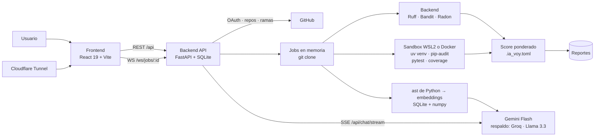

# IA voy

Analizador de calidad de código **Python** para equipos. El usuario indica un repositorio Git
(URL + rama); el backend lo clona, ejecuta seis analizadores en un sandbox, calcula un **score
ponderado** por categoría (seguridad, pruebas, buenas prácticas) y genera un **reporte** navegable.
Sobre el reporte se puede abrir el código en un editor, aplicar correcciones automáticas, preguntar
a un asistente IA (RAG), comparar análisis y compartir el reporte con un enlace público.

> **Solo analiza Python.** Un repositorio sin archivos `.py` (JavaScript, Java…) se detiene con un mensaje
> claro y la lista de lenguajes que trae. Si Python es minoría, el análisis avisa que el resto no se analiza.

| Parte | Estado | Dónde |
|---|---|---|
| Prototipo navegable (HTML único) | ✅ referencia | [ia_voy_prototipo.html](ia_voy_prototipo.html) |
| Frontend (React + Vite + Tailwind) | ✅ implementado; usa el backend real (o MSW si se activan los mocks) | [frontend/](frontend) |
| Backend (FastAPI) | ✅ completo: login con GitHub, **equipos**, análisis con analizadores elegibles (sandbox WSL2/Docker para pytest, coverage y pip-audit), jobs persistentes, tablero, reportes, editor, asistente IA con streaming, configuración, comparativa y compartir / vista pública | [backend/](backend) |
| Documentación técnica (LaTeX) | ✅ entregada | [docs/latex/](docs/latex) |

Versión **1.0** (Sprint 10, 1 de diciembre de 2026): backend `pytest` → 195 pruebas pasan; frontend `npm test` → 22 pruebas
unitarias, `npm run test:e2e` → 8 pruebas (los 5 flujos del spec, reintento, equipo y analizadores) pasan;
`npm run build` sin errores.

Documentación detallada:

- [docs/FRONTEND_SPEC.md](docs/FRONTEND_SPEC.md) — pantallas, flujos, modelos de datos y contrato REST/WS.
- [docs/FRONTEND_STRUCTURE.md](docs/FRONTEND_STRUCTURE.md) — estructura de carpetas, rutas y convenciones del frontend.
- [backend/README.md](backend/README.md) — puesta en marcha del backend, claves de `.env` y flujo OAuth de GitHub.

---

## 1. Arquitectura



### 1.1 Componentes

| Componente | Responsabilidad | Tecnología |
|---|---|---|
| **Frontend** | UI: tablero, análisis en vivo, reporte, editor, asistente, comparativa, configuración, vista pública | React 19, TypeScript, Vite 8, Tailwind 4, React Router 7, TanStack Query 5, Zustand 5, Monaco |
| **API** | Autenticación, repos, reportes, archivos, fixes, chat, configuración, enlaces públicos | FastAPI + Uvicorn, SQLite; REST bajo `/api`, WebSocket bajo `/ws` |
| **Integración GitHub** | Vincular la cuenta por OAuth y listar repos (incluidos privados) y ramas; el token se guarda cifrado (Fernet) y nunca llega al navegador | `httpx`, `cryptography` |
| **Worker de análisis** | Ejecuta los 11 pasos de un job (en memoria) y emite el progreso por WebSocket | `git clone`; sandbox WSL2 o Docker con `uv` (`SANDBOX`) |
| **Analizadores** | Generan los hallazgos de cada categoría | Ruff, Bandit, Radon en el backend; pip-audit, pytest, coverage en el sandbox (simulados con `SANDBOX=off`) |
| **Índice RAG** | Fragmenta el código (una función/clase por fragmento) y lo indexa para el asistente | `ast` de Python, `gemini-embedding-001`, SQLite + numpy (coseno) |
| **LLM** | Responde preguntas sobre el código con fuentes `archivo:línea`, por streaming (SSE) | `gemini-3.8-flash` → respaldos `gemini-3.5-flash`, `gemini-3.1-flash-lite` → Groq (Llama 3.3) si responden `429`/`503` |
| **Exposición pública** | Publica la app y los enlaces `/r/:shareId` | Cloudflare Tunnel |

### 1.2 Flujo de un análisis

1. `POST /api/analyze` con `{url, branch, analyzers, sandbox, index}` → `{job_id, analysis_num}`.
2. El frontend abre `WS /ws/jobs/{job_id}` y recibe `snapshot`, `step`, `log`, `step_done`, `error` y `done`.
3. El worker ejecuta los pasos (ver [§3.3](#33-pasos-que-ejecuta-el-backend-en-cada-análisis)).
4. Con `done` el frontend invalida las consultas y abre el reporte (`GET /api/report/{id}`).

### 1.3 Score

```
score = (w.seg·seg + w.test·test + w.prac·prac) / (w.seg + w.test + w.prac)
```

Pesos por defecto `seg = 50`, `test = 30`, `prac = 20`, configurables por proyecto en `.ia_voy.toml`.
El frontend solo lo previsualiza; el valor oficial lo calcula el backend.

### 1.4 Arquitectura del frontend

*Feature-based*: un módulo por dominio del backend, con dependencias en una sola dirección
`app → features → shared`.

```text
frontend/src/
├── app/        router, guards, layouts (AppShell, SoloLayout), providers
├── features/   auth · dashboard · repos · analysis · github · report · findings · share
│               editor · assistant · compare · settings · public-report
│               (cada uno: api/, types.ts, store/, components/, pages/, index.ts)
├── shared/     api (http, ws, endpoints, queryClient), ui (design system), hooks,
│               constants, utils, types
└── mocks/      backend simulado con MSW (HTTP + WebSocket)
```

- Solo la capa `api/` habla con el backend; los componentes usan hooks de TanStack Query.
- Datos del servidor en TanStack Query; estado de UI en Zustand o en query params (todo enlazable).
- Los tipos de `features/*/types.ts` son el contrato con el backend: si el backend los respeta, basta
  con poner `VITE_USE_MOCKS=false`.

Detalle completo en [docs/FRONTEND_STRUCTURE.md](docs/FRONTEND_STRUCTURE.md).

---

## 2. Herramientas necesarias

Estado revisado el 2026-10-17 en la máquina de desarrollo (Windows 11):

| Herramienta | Versión requerida | Instalada | Dónde | Para qué |
|---|---|---|---|---|
| Node.js | ≥ 20.19 | ✅ 20.20.2 | Windows | Frontend (Vite 8) |
| npm | ≥ 10 | ✅ 10.8.2 | Windows | Dependencias del frontend (`node_modules` ✅) |
| Git | reciente | ✅ 2.54.0 | Windows | Control de versiones y clonado de repos |
| GitHub CLI (`gh`) | — | ✅ 2.102.0 | Windows | PRs e issues (opcional) |
| Python | ≥ 3.12 (`pyproject.toml`) | ✅ 3.12.7 | Windows | Backend |
| `uv` | — | ✅ 0.13.1 | Windows y WSL | Entornos del backend y del sandbox (`uv venv`, `uv pip`) |
| WSL2 + Ubuntu | — | ✅ WSL 2.7.11, Ubuntu-24.04 | Windows | Sandbox donde corren los analizadores |
| Docker | — | ✅ 29.7.2 | Windows | Opcional (alternativa de sandbox) |
| pytest | ≥ 8.3 | ✅ 9.1.1 | `backend/.venv` y WSL | Pruebas del backend y paso 6 del análisis |
| coverage | — | ✅ 7.16.2 | WSL | Paso 7 del análisis |
| Bandit | — | ✅ 1.9.4 | WSL | Paso 4 del análisis (seguridad) |
| pip-audit | — | ✅ 2.10.1 | WSL | Paso 5 del análisis (vulnerabilidades) |
| Ruff | — | ✅ 0.17.1 | WSL | Paso 8 del análisis (estilo / lint) |
| Radon | — | ✅ 6.0.1 | WSL | Paso 9 del análisis (complejidad) |
| `cloudflared` | — | ✅ 2026.10.1 | Windows | Túnel público (opcional en desarrollo) |

Además, para el backend:

- ✅ `backend/.venv` creado con sus dependencias (FastAPI, Uvicorn, httpx, pydantic-settings,
  cryptography, Ruff, Bandit, Radon, numpy, pytest). `pytest`: 195 pruebas pasan.
- ✅ `backend/.env` creado a partir de `.env.example` (ver [§3.2](#32-backend)), con `SANDBOX=wsl`.
- ✅ Sandbox WSL2 probado de punta a punta con `seed_data/demo_repo`: entorno, dependencias,
  pip-audit (5 paquetes vulnerables), pytest (2 pasan) y coverage reales en ~16 s.
- El asistente no usa SDK: llama a Gemini y Groq por HTTP con `httpx`, y guarda los embeddings en
  SQLite (no hace falta ChromaDB ni tree-sitter).

### 2.1 Instalación en una máquina nueva

```powershell
# Windows
winget install astral-sh.uv
winget install Cloudflare.cloudflared
```

```bash
# Dentro de WSL (Ubuntu-24.04), donde corre el sandbox de análisis
curl -LsSf https://astral.sh/uv/install.sh | sh
source $HOME/.local/bin/env              # agrega ~/.local/bin al PATH
uv tool install bandit
uv tool install pip-audit
uv tool install ruff
uv tool install radon
uv tool install pytest --with coverage   # pytest y coverage también dentro del sandbox
```

El sandbox de WSL solo necesita `uv` (crea un entorno por análisis e instala ahí pytest y coverage) y
usa `uvx pip-audit`. Con Docker no hace falta instalar nada: basta `SANDBOX=docker` y Docker Desktop
corriendo (usa la imagen `ghcr.io/astral-sh/uv:python3.12-bookworm-slim`).

Verificar:

```bash
uv --version; bandit --version; pip-audit --version; ruff --version; radon --version; cloudflared --version
```

---

## 3. Comandos

### 3.1 Frontend

Todos se ejecutan dentro de [frontend/](frontend):

```bash
cd frontend
npm install          # instala dependencias
npm run dev          # servidor de desarrollo en http://localhost:5173 (usa el backend en :8000)
npm run build        # verificación de tipos (tsc -b) + build de producción en dist/
npm run preview      # sirve el build de dist/ localmente
npm run lint         # oxlint
npm test             # pruebas unitarias (Vitest, tests/unit)
npm run test:watch   # pruebas en modo watch
npm run test:e2e     # los 5 flujos del spec en Chrome (Playwright, tests/e2e, backend simulado con MSW)
```

Las pruebas e2e levantan su propio Vite en el puerto 5174 con `.env.e2e` (mocks + sesión automática) y
usan el Chrome instalado. Sin Chrome: `npx playwright install chromium` y `PW_CHANNEL=chromium npm run test:e2e`.

**Con el backend real** (por defecto): `.env.development` trae `VITE_USE_MOCKS=false` y Vite redirige
`/api` y `/ws` a `http://localhost:8000`. El login es con GitHub, así que el backend necesita su
OAuth App configurada (ver [§3.2](#32-backend)).

**Sin backend**, crea `frontend/.env.development.local` (ignorado por git) para usar los mocks de MSW
y entrar directo con la cuenta de prueba `ana@equipo.dev` / `demo1234`:

```dotenv
VITE_USE_MOCKS=true
VITE_AUTO_LOGIN=true
```

| Variable | Valor por defecto | Descripción |
|---|---|---|
| `VITE_API_URL` | vacío (mismo origen) | Base de la API REST |
| `VITE_WS_URL` | vacío (mismo origen) | Base del WebSocket de jobs |
| `VITE_PROXY_TARGET` | `http://localhost:8000` | Backend al que el proxy de Vite redirige `/api` y `/ws` |
| `VITE_USE_MOCKS` | `false` | Responde `/api` con MSW, sin backend |
| `VITE_AUTO_LOGIN` | `false` | Inicia sesión sola (solo con mocks) |

Si se actualiza `msw`, regenerar el service worker con `npx msw init public`.

### 3.2 Backend

Se ejecutan dentro de [backend/](backend). Escucha en `http://localhost:8000` (el `VITE_PROXY_TARGET`
del frontend).

```powershell
cd backend
python -m venv .venv
.\.venv\Scripts\python.exe -m pip install -e ".[dev]"     # dependencias + pytest
copy .env.example .env                                   # luego llenar las claves
.\.venv\Scripts\python.exe -m uvicorn app.main:app --reload --port 8000
.\.venv\Scripts\python.exe -m pytest                     # pruebas (sin llamadas de red)
```

Con `uv`:

```bash
cd backend
uv sync --extra dev
uv run uvicorn app.main:app --reload --port 8000
uv run pytest
```

Documentación interactiva de la API: `http://localhost:8000/docs`.

Claves de `backend/.env` (detalle en [backend/README.md](backend/README.md#claves-de-env)):

| Variable | Cómo obtenerla |
|---|---|
| `FRONTEND_URL` | `http://localhost:5173` (CORS y `redirect_uri` de GitHub) |
| `SECRET_KEY` / `TOKEN_ENCRYPTION_KEY` | Opcionales: si están vacías se generan y se guardan en `data/secrets.json` |
| `GITHUB_CLIENT_ID` / `GITHUB_CLIENT_SECRET` | GitHub → Settings → Developer settings → OAuth Apps. Callback: `http://localhost:5173/github/callback` |
| `DATABASE_PATH` | `data/ia_voy.db` (SQLite, se crea sola) |
| `CLONES_PATH` | Carpeta de los clones (por defecto `%LOCALAPPDATA%\ia-voy\repos`; evitar OneDrive) |
| `JOB_STEP_SECONDS` | Pausa visual entre pasos del análisis (0.9 s) |
| `SANDBOX` | `wsl` (en `.env.example`), `docker` u `off` (pytest, coverage y pip-audit simulados). Ver [backend/README.md](backend/README.md#sandbox) |
| `SANDBOX_WSL_DISTRO` | Distribución de WSL del sandbox (`Ubuntu-24.04`) |
| `GEMINI_API_KEY` | Asistente IA: https://aistudio.google.com/apikey (sin ella responde `503 llm_not_configured`) |
| `GEMINI_MODEL` / `GEMINI_FALLBACK_MODELS` | Opcionales; por defecto `gemini-3.8-flash` y `gemini-3.5-flash,gemini-3.1-flash-lite` |
| `GROQ_API_KEY` | Opcional, último respaldo del asistente: https://console.groq.com/keys |

Los jobs, los `state` de OAuth y los intentos de contraseña de los enlaces viven en SQLite: el backend
puede correr con **varios workers** (`--workers N`) y un reinicio a mitad de un análisis lo deja en error,
listo para reintentar.

Datos de demostración sin analizar un repo real (después de entrar una vez con GitHub):

```powershell
.\.venv\Scripts\python.exe -m app.seed --login tu-usuario-de-github
```

#### Endpoints

Contrato completo en [docs/FRONTEND_SPEC.md §6](docs/FRONTEND_SPEC.md). Todos están implementados en el
backend.

| | Módulo | Endpoints |
|---|---|---|
| ✅ | Auth (login con GitHub) | `POST /api/auth/github/authorize`, `POST /api/auth/github/callback`, `POST /api/auth/logout`, `GET /api/auth/me` |
| ✅ | Equipo (los repos, reportes y configuración son del equipo) | `GET`/`PATCH /api/team`, `POST /api/team/invites`, `GET /api/team/invites/{code}`, `POST /api/team/join`, `DELETE /api/team/members/{id\|me}`, `POST /api/team/members/{id}/owner` |
| ✅ | GitHub (repos de la cuenta con la que se inició sesión) | `GET /api/github/status`, `GET /api/github/repos?q=`, `GET /api/github/repos/{owner}/{repo}/branches` |
| ✅ | Tablero / repos | `GET /api/dashboard?repo=`, `GET /api/repos`, `GET /api/repos/{id}/history`, `POST /api/repos/{id}/analyze` |
| ✅ | Análisis (analizadores elegibles, al menos uno por categoría; pytest, coverage y pip-audit en el sandbox) | `POST /api/analyze`, `WS /ws/jobs/{id}`, `GET /api/jobs/{id}`, `DELETE /api/jobs/{id}`, `POST /api/jobs/{id}/retry` |
| ✅ | Reporte | `GET /api/report/{id}` (`id` puede ser `latest` con `?repo=`), `GET /api/report/{id}/export?format=json\|html\|md\|sarif` |
| ✅ | Editor | `GET /api/repos/{id}/tree`, `GET /api/file?repo=&path=`, `PUT /api/file`, `POST /api/fix` |
| ✅ | Asistente (Gemini + RAG en SQLite; respuesta por streaming SSE) | `POST /api/chat/stream`, `POST /api/chat`, `GET /api/repos/{id}/index` |
| ✅ | Comparativa (nuevos y resueltos entre dos análisis del mismo repo) | `GET /api/repos/{id}/analyses`, `POST /api/diff` |
| ✅ | Configuración | `GET /api/projects/{id}/config`, `PUT /api/projects/{id}/config` (+ `.ia_voy.toml`), `GET /api/health` |
| ✅ | Compartir (contraseña opcional con scrypt, expiración, fragmentos de código opcionales) | `POST /api/report/{id}/share` |
| ✅ | Público (sin sesión; `401` con contraseña, `410` si expiró) | `GET /api/public/r/{id}`, `POST /api/public/r/{id}/unlock` |

Errores en formato `{ "error": { "code": "...", "message": "..." } }`.

### 3.3 Pasos que ejecuta el backend en cada análisis

Son los comandos que muestra la terminal en vivo del frontend:

| # | Paso | Comando | Dónde corre |
|---|---|---|---|
| 1 | Clonar repositorio | `git clone --depth 1 --branch {branch} {url}` | backend |
| 2 | Crear entorno aislado | `uv venv .venv` | sandbox |
| 3 | Instalar dependencias | `uv pip install -r requirements.txt` | sandbox |
| 4 | Bandit (seguridad) | `bandit -r . -f json` | backend (solo lee el código) |
| 5 | pip-audit (seguridad) | `pip-audit --path .venv/…/site-packages -f json` | sandbox |
| 6 | pytest (pruebas) | `coverage run -m pytest -q --maxfail=50` | sandbox |
| 7 | coverage (pruebas) | `coverage json` | sandbox |
| 8 | Ruff (prácticas) | `ruff check . --output-format json` | backend |
| 9 | Radon (prácticas) | `radon cc . -j && radon mi . -j` | backend |
| 10 | Calcular score | agregación ponderada según la configuración del proyecto | backend |
| 11 | Indexar para el asistente | `ast` → embeddings de Gemini → SQLite | backend |

El sandbox corre en paralelo con Ruff/Bandit/Radon y la terminal avanza con cada fase. Con `SANDBOX=off`
(o si el sandbox no está disponible, o se desmarca "Ejecutar en sandbox" en el formulario) los pasos del
sandbox se simulan: sus números salen de una semilla del job y sus hallazgos dicen "(simulado)".

Los analizadores que no se marcan en el formulario no corren: su paso dice "omitido (no seleccionado)" y no
aportan hallazgos. Hay que elegir al menos uno por categoría. Sin coverage, la cobertura sale "no medida"
y el score de pruebas solo descuenta las pruebas que fallan. Re-analizar usa los mismos analizadores.

### 3.4 Equipos

Cada usuario pertenece a un equipo; el primer login crea uno propio ("Equipo de Ana"). Los repos, reportes,
configuración, jobs y el índice del asistente son del equipo. En **Equipo** (`/team`) quien lo administra
crea un enlace de invitación (`/join/{code}`, 7 días, para varias personas), renombra, cede el equipo y quita
miembros; un miembro puede salirse. Al unirse, los repos de quien llega pasan al equipo (si el equipo ya
tenía alguno con el mismo nombre, se queda el del equipo; la invitación lo avisa antes).

Configuración por proyecto (`.ia_voy.toml` en la raíz del repo analizado):

```toml
[pesos]
seguridad = 0.50
pruebas   = 0.30
practicas = 0.20

[umbrales]
score_minimo     = 70
cobertura_minima = 60

[reglas]
ignorar = ["S101", "D100"]

[rutas]
excluir = ["migrations/", "tests/fixtures/"]
```

### 3.5 Exposición pública

```bash
cloudflared tunnel --url http://localhost:5173   # publica la app (y los enlaces /r/:shareId)
```

---

## 4. Estructura del repositorio

```text
IA-VOY/
├── README.md                 este archivo
├── CHANGELOG.md              cambios por versión
├── ia_voy_prototipo.html     prototipo navegable original
├── docs/
│   ├── FRONTEND_SPEC.md      especificación funcional y contrato con el backend
│   ├── FRONTEND_STRUCTURE.md estructura y convenciones del frontend
│   ├── guia-usuario.md       guía de usuario
│   ├── despliegue.md         publicación con Cloudflare Tunnel
│   ├── adr/                  decisiones de arquitectura
│   ├── ia/                   prompts, catálogo de reglas, score, evaluación del asistente, informe técnico
│   ├── qa/                   parsing, QA manual, sandbox Docker, reporte final, trazabilidad
│   └── latex/                documentación técnica (ia-voy-documentacion.tex, compila con pdflatex u Overleaf)
├── frontend/                 aplicación React (ver §1.4)
│   ├── tests/unit/           Vitest
│   └── tests/e2e/            Playwright: los 5 flujos del spec
├── backend/                  API FastAPI (detalle en backend/README.md)
│   ├── app/main.py           crea la app, CORS, routers
│   ├── app/auth.py           login con GitHub y sesión de la app (tokens HMAC)
│   ├── app/github/           cliente de la API de GitHub, tokens cifrados en SQLite
│   ├── app/teams/            equipos e invitaciones
│   ├── app/analysis/         jobs, WebSocket, clonado, pipeline de analizadores y sandbox
│   ├── app/analyses/         almacenamiento de reportes/hallazgos, score, .ia_voy.toml
│   ├── app/dashboard/        tablero, repos e historial
│   ├── app/reports/          reporte y exportación (json, md, html, sarif)
│   ├── app/editor/           árbol, lectura/guardado de archivos y fixes de Ruff
│   ├── app/assistant/        chunker (ast), índice de embeddings y cliente LLM
│   ├── app/projects/         configuración del proyecto
│   ├── app/compare/          comparativa entre análisis
│   ├── app/share/            enlaces públicos del reporte
│   ├── app/seed.py           datos de demostración (seed_data/demo_repo)
│   └── tests/                pytest (GitHub y el LLM sustituidos por clientes falsos)
└── .github/workflows/ci.yml  CI: pytest, build, Vitest y Playwright en cada PR
```

## 5. Documentación de entrega

| Documento | Contenido |
|---|---|
| [docs/guia-usuario.md](docs/guia-usuario.md) | Guía de usuario: de iniciar sesión a compartir un reporte |
| [docs/despliegue.md](docs/despliegue.md) | Publicar la app con Cloudflare Tunnel |
| [docs/ia/informe-tecnico.md](docs/ia/informe-tecnico.md) | Informe técnico de IA: motor determinista, score y asistente RAG |
| [docs/latex/](docs/latex) | Documentación técnica completa (LaTeX) |
| [docs/FRONTEND_SPEC.md](docs/FRONTEND_SPEC.md) · [docs/FRONTEND_STRUCTURE.md](docs/FRONTEND_STRUCTURE.md) | Especificación y estructura del frontend |
| [docs/adr/](docs/adr) | Decisiones de arquitectura (motor determinista, sandbox) |
| [docs/qa/reporte-final.md](docs/qa/reporte-final.md) | Reporte final de calidad |
| [docs/qa/trazabilidad.md](docs/qa/trazabilidad.md) | Matriz de trazabilidad requisito → código → prueba |
| [CHANGELOG.md](CHANGELOG.md) | Cambios por versión (un release por sprint) |

## 6. Limitaciones conocidas

1. **Túnel de Cloudflare**: `/api/health` muestra un estado fijo ("Túnel inactivo"); el túnel se levanta aparte
   (ver [docs/despliegue.md](docs/despliegue.md)).
2. **Sandbox**: antes de publicar la app para otras personas, usar `SANDBOX=docker` (ver
   [docs/qa/sandbox-docker.md](docs/qa/sandbox-docker.md)); el modo WSL2 puede leer el disco de Windows (`/mnt/c`).
3. **Pruebas e2e** con el backend simulado (MSW): el login real pasa por GitHub; los flujos contra el backend real
   están en [docs/qa/qa-manual.md](docs/qa/qa-manual.md).
4. `GithubCallbackPage` deja un aviso de oxlint a propósito: el efecto consume un login de un solo uso y moverlo
   al render rompe con StrictMode.
