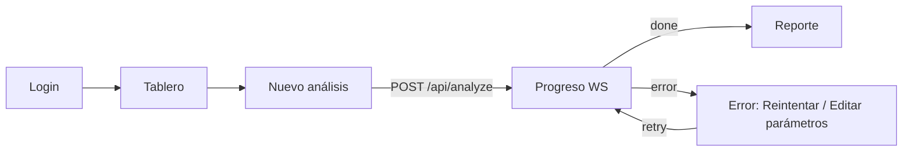
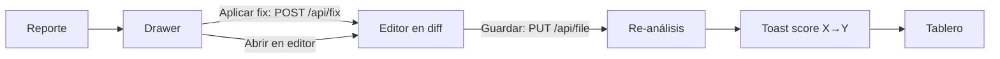

# IA voy — Especificación del Frontend (ingeniería inversa de `ia_voy_prototipo.html`)

> Documento obtenido por ingeniería inversa del prototipo navegable `ia_voy_prototipo.html`.
> Describe **todo** lo que el frontend debe hacer: pantallas, flujos, componentes, estado, acciones
> y el contrato REST/WebSocket esperado con el backend. Es agnóstico al framework; la elección del
> framework se hará después.

---

## 1. Visión general

**IA voy** es un analizador de calidad de código **Python** para equipos. El usuario indica un
repositorio Git (URL + rama); el backend lo clona, ejecuta seis analizadores en un sandbox, calcula un
**score ponderado** por categoría y genera un **reporte** navegable. Sobre el reporte se puede:

- Ver hallazgos con detalle (por qué importa / cómo corregirlo).
- Abrir el código en un **editor**, aplicar **correcciones automáticas**, revisar un **diff** y guardar
  (lo que dispara un re‑análisis del archivo).
- Preguntar a un **asistente IA (RAG)** sobre el código con fuentes citadas (archivo:línea).
- **Comparar** dos análisis (o ramas).
- **Compartir** el reporte mediante un enlace público (contraseña, expiración, exportación).
- **Configurar** pesos, umbrales, reglas ignoradas y rutas excluidas (`.ia_voy.toml`).

### 1.1 Stack observado en el prototipo (referencia, no obligatorio)

| Aspecto | Prototipo | Nota para la versión real |
|---|---|---|
| Estilos | Tailwind CSS (CDN) con `darkMode: 'class'` | Mantener Tailwind (build, no CDN) |
| Tipografía | Inter (UI) + JetBrains Mono (código) | Igual |
| Iconos | SVG inline (stroke 1.8, viewBox 24) — mapa `P` | Componente `<Icon name>` o librería (lucide) |
| Router | Hash router `#/ruta` | Router del framework (history mode) |
| Estado | Objeto global mutable `S` | Store global + caché de servidor |
| Datos | Mock en memoria (`REPOS`, `FINDINGS`, `CODE`…) | API REST + WebSocket |
| Editor | `contenteditable` por línea | **Monaco Editor** (indicado en el propio prototipo) |
| Gráficas | SVG generado a mano | Librería de charts o componente SVG propio |

### 1.2 Servicios externos referenciados en la UI

| Servicio | Uso | Dónde se muestra |
|---|---|---|
| Gemini 2.5 Flash | LLM principal del asistente | Sidebar footer, Chat, Configuración |
| Groq · Llama 3.3 | Respaldo cuando Gemini responde **429** | Sidebar, Chat, Configuración |
| Cloudflare Tunnel | Exposición pública (`ia-voy.trycloudflare.com`) | Sidebar, enlace de compartir |
| Sandbox WSL2 | Ejecución aislada de pytest | Nuevo análisis, Configuración |
| ChromaDB + tree-sitter + embeddings | Índice RAG del repositorio | Pasos del job, Chat |

---

## 2. Arquitectura de la interfaz

### 2.1 Layouts

| Layout | Rutas | Estructura |
|---|---|---|
| **AppShell** (autenticado) | todas excepto `login` y `compartido` | Sidebar fija (w‑64, colapsable en móvil) + Header sticky (h‑16) + `<main>` (max‑w‑7xl) |
| **SoloLayout** (sin shell) | `login`, `compartido` (`/r/{share_id}`) | Pantalla completa, sin sidebar ni header de app |

Capas globales siempre montadas:
- `#overlay` → Drawer de hallazgo / Modal de compartir (uno a la vez).
- `#toasts` → pila de notificaciones abajo a la derecha (z‑60).

### 2.2 Sidebar (`Sidebar`)

- Logo "IA" (gradiente brand → fuchsia) + "IA voy · Analizador de código Python".
- Navegación agrupada (constante `NAV`):

| Grupo | Item | Ruta | Icono |
|---|---|---|---|
| Prototipo* | Mapa de flujo | `flujo` | flow |
| Prototipo* | Pantalla de acceso | `login` | lock |
| Prototipo* | Vista pública | `compartido` | globe |
| Principal | Tablero | `dashboard` | home |
| Principal | Nuevo análisis | `analizar` | plus |
| Principal | Repositorios | `repos` | folder |
| Análisis | Reporte | `reporte` | doc — **badge** con nº de hallazgos *alta* sin resolver |
| Análisis | Editor | `editor` | code |
| Análisis | Asistente IA | `chat` | chat |
| Análisis | Comparativa | `comparar` | compare |
| Sistema | Configuración | `config` | sliders |

\* El grupo "Prototipo" es solo para la demo; **no va en producción** (el `flujo` es documentación).

- Footer de estado de servicios:
  - "Túnel activo" con punto verde animado (`ping`) + host del túnel.
  - Modelo LLM activo ("Gemini 2.5 Flash") + estado del respaldo ("Groq en espera").
  - → En la versión real debe venir de `GET /api/health` (ver §6).
- Móvil (< lg): se abre con botón hamburguesa, overlay oscuro con blur; se cierra al navegar o al tocar el overlay.

### 2.3 Header (`TopBar`)

- Botón hamburguesa (solo móvil).
- **Título de página** (`TITLES[ruta]`).
- **Búsqueda global** (md+): input; `Enter` → `globalSearch(q)` = navegar a Reporte con `filters.q = q`, `sev = cat = 'todas'`, `tab = 'hallazgos'`, y limpia el input.
- **Job pill** (`JobPill`): si hay un análisis en curso muestra "⟳ Analizando NN %"; si falló "⚠ Falló". Clic → `analizar`. Oculto si no hay job o si terminó y ya estás en `analizar`.
- **Toggle de tema** claro/oscuro (persistido en `localStorage['iavoy-theme']`; por defecto `prefers-color-scheme`).
- **Menú de usuario** (avatar con iniciales "AL", nombre "Ana L."):
  - Cabecera: nombre completo + "Equipo Backend · 6 miembros".
  - Configuración → `config`.
  - Ver un reporte público → `compartido` (solo demo).
  - Cerrar sesión → `login` (real: `POST /api/auth/logout`).
  - Se cierra con clic fuera.

### 2.4 Atajos y comportamiento global

- `Esc` → cierra drawer/modal.
- Abrir drawer/modal bloquea el scroll del `body`.
- Al navegar se hace scroll al tope; `refresh()` re-renderiza conservando scroll.
- Ruta por defecto / desconocida → `flujo` (en producción: `dashboard` si hay sesión, `login` si no).

---

## 3. Sistema de diseño (design tokens)

### 3.1 Colores de marca

`brand` (violeta): 50 `#f0f0ff` · 100 `#e3e2ff` · 200 `#cbc9ff` · 300 `#a9a4fd` · 400 `#8a7ff8` ·
500 `#7060f1` · **600 `#5f45e4` (BRAND / acción principal)** · 700 `#5037c9` · 800 `#422fa3` · 900 `#382c81`.

Regla: **violeta = acción**. Cada color tiene un único significado en toda la interfaz.

Fondos: claro `#f8fafc` (slate‑50), oscuro `#020617` (slate‑950). Panel editor oscuro `#0b1120`.

### 3.2 Categorías (`CAT`)

| Clave | Etiqueta | Icono | Hex | Herramientas |
|---|---|---|---|---|
| `seg` | Seguridad | shield | `#d946ef` (fuchsia) | Bandit · pip-audit |
| `test` | Pruebas | beaker | `#0ea5e9` (sky) | pytest · coverage |
| `prac` | Buenas prácticas | sparkle | `#14b8a6` (teal) | Ruff · Radon |

### 3.3 Severidad (`SEV`)

| Clave | Etiqueta | Color | Uso extra |
|---|---|---|---|
| `alta` | Alta | rose | fondo de línea en editor `rose-500/7%` |
| `media` | Media | amber | `amber-500/7%` |
| `baja` | Baja | slate | `slate-500/6%` |

Orden de prioridad: `alta` > `media` > `baja`.

### 3.4 Tono de score (`TONE`, función `tone(v)`)

| Rango | Clave | Etiqueta | Hex |
|---|---|---|---|
| 80 – 100 | `good` | Saludable | `#10b981` |
| 60 – 79 | `warn` | Mejorable | `#f59e0b` |
| 0 – 59 | `bad` | Crítico | `#f43f5e` |

### 3.5 Grados de complejidad (Radon, `GRADE`)

A emerald · B lime · C amber · D orange · E rose · F rose‑700.

### 3.6 Clases reutilizables (`C`) → componentes base

| Token | Componente sugerido |
|---|---|
| `card` | `<Card>` — blanco/slate‑900, borde, `rounded-2xl`, sombra suave |
| `btn` | `<Button variant="primary">` — brand‑600, `rounded-xl`, focus ring |
| `btn2` | `<Button variant="secondary">` — borde, fondo blanco |
| `ghost` | `<Button variant="ghost">` — sin borde, hover gris |
| `input` | `<Input>` / `<Select>` — `rounded-xl`, focus ring brand |
| `label` | `<Label>` |
| `h1` | `<PageTitle>` (2xl / sm:3xl bold) |
| `sub` | `<Subtitle>` (sm, slate‑500) |
| `chip` | `<Chip>` / `<Badge>` (rounded‑full, ring inset) |

### 3.7 Animaciones

- `fade-in` (0.22 s, translateY 6px) — entrada de páginas, toasts, modales.
- `slide-in` (0.25 s, desde la derecha) — drawer.
- `dot-typing` — indicador "escribiendo…" del chat.
- Ring de score: transición `stroke-dashoffset .8s`.
- Spinner `SPIN` (animate-spin).

### 3.8 Resaltado de sintaxis Python (`hl`)

Tokens: strings (`tok-s` verde), comentarios (`tok-c` gris itálica), keywords (`tok-k` violeta: def, return, import, from, is, not, None, and, or, if, else, class, for, in, True, False, with, as, raise, lambda), números (`tok-n` naranja). En la versión real lo resuelve Monaco / Shiki.

---

## 4. Componentes reutilizables

| Componente | Origen en prototipo | Props | Descripción |
|---|---|---|---|
| `Icon` | `icon(n, c)` / `data-i` | `name`, `class` | 38 iconos SVG (ver lista en §4.1) |
| `Spinner` | `SPIN(c)` | `class` | Círculo girando |
| `ScoreRing` | `ring(v,size,sw)` | `value`, `size`(40/64/96/112/120), `stroke` | Anillo circular coloreado por `tone`; muestra 1 decimal si size>80 |
| `DeltaBadge` | `deltaBadge(d,big)` | `delta`, `big` | ▲ verde / ▼ rojo con 1 decimal; "sin cambios" si |d|<0.05 |
| `SeverityBadge` | `sevBadge(s)` | `sev` | Punto + etiqueta |
| `CategoryChip` | `catChip(c)` | `cat` | Icono + etiqueta con color |
| `StatusChip` | `statusChip(s)` | `status` (`listo`/`analizando`/`error`) | Check / spinner / alerta |
| `ProgressBar` | `bar(v,cls)` | `value`, `colorClass` | Barra fina h‑1.5 |
| `Toggle` | dentro de `openShare` | `checked`, `onChange` | Switch `role="switch"` |
| `Toast` | `toast(msg,opt)` | `msg`, `tone` (`ok`/`err`/`info`), `action:[label, fn]`, `ms` (4500 def.) | Notificación con acción opcional y cierre |
| `Drawer` | `openDrawer` | `findingId` | Panel lateral derecho w‑30rem |
| `Modal` | `openShare` | — | Centrado, max‑w‑lg, scroll interno |
| `TrendChart` | `chart(r)` | `series`, `hidden` | Líneas global/seg/test/prac + área bajo global + leyenda clicable |
| `CodeSnippet` | dentro de `openDrawer` | `lines`, `highlightLine`, `sev` | ±2 líneas alrededor del hallazgo |
| `CodeView` | `codeLines(file,mode)` | `file`, `mode` (`edit`/`orig`/`new`) | Líneas numeradas con marcas de hallazgo, +/−, inline actions |
| `ChipList` | `chipList(list,ph)` | `items`, `placeholder`, `onAdd`, `onRemove` | Lista editable de etiquetas |
| `EmptyState` | en `findingRows` | `message`, `action` | "Sin hallazgos con esos filtros · Limpiar filtros" |
| `Breadcrumb` | en Reporte | `items` | Repositorios › repo › #num |
| `Tabs` | en Reporte | `tabs`, `active` | Subrayado brand‑600 |
| `SegmentedControl` | filtros de severidad | `options`, `value` | Todas/Alta/Media/Baja |
| `TerminalLog` | `jobView` | `lines`, `live` | Ventana estilo terminal con colores por tipo de línea |
| `StepList` | `jobView` | `steps`, `current`, `status` | ok / run / err / wait |

### 4.1 Iconos usados

flow, home, plus, folder, doc, code, chat, compare, sliders, lock, globe, shield, beaker, sparkle,
share, download, sun, moon, menu, x, search, check, arrow, chevron, refresh, copy, send, wand, eye,
branch, file, alert, clock, play, ban, bolt, save, diff.

---

## 5. Pantallas (vistas) — detalle

> Para cada pantalla: propósito, secciones, acciones, estados y endpoints.

### 5.1 Login — `/login` (SoloLayout)

**Propósito:** acceso solo para miembros del equipo.

- Panel izquierdo (lg+): gradiente brand, logo, claim "Calidad de código Python, medida y explicada.", tarjetas de las 3 categorías con sus herramientas, pie "Proyecto académico · 2026".
- Panel derecho: botón de tema; formulario:
  - `Correo` (email, requerido)
  - `Contraseña` (password, requerido) + enlace "¿La olvidaste?" → toast info "Pide a quien administra el equipo que restablezca tu acceso" (no hay flujo de reset self‑service).
  - Checkbox "Mantener sesión iniciada" (default ✓).
  - Botón "Entrar →".
  - Enlace "¿Solo quieres ver un reporte compartido? Ábrelo aquí" → vista pública.
- **Submit:** `POST /api/auth/login` → éxito: navegar a `dashboard` + toast "Bienvenida de nuevo, {nombre}". Error: toast `err`.

### 5.2 Tablero — `/dashboard`

**Endpoint:** `GET /api/dashboard` (y opcional `?repo={id}`).

- **Cabecera:** fecha + "N repositorios activos"; título "Resumen del equipo"; `Select` de repositorio (solo repos con score); botón primario "+ Nuevo análisis" → `analizar`.
- **Fila KPI (4 tarjetas):**
  1. **Score global** — `ScoreRing` 96px, nombre del repo, `DeltaBadge` vs. análisis anterior, chip "Supera / No supera el umbral (N)" según `thr.score`.
  2–4. **KPI por categoría** (`seg`, `test`, `prac`): icono, etiqueta, herramientas, valor `/100` coloreado por tono, delta vs. anterior, barra. **Clic** → Reporte filtrado por esa categoría.
- **Tendencia** (lg: 2/3): `TrendChart` con 7 fechas (últimas 7 semanas), series Global (más gruesa + área) y por categoría; leyenda clicable para ocultar/mostrar series; botón ghost "Comparar" → `comparar`.
- **Atención prioritaria** (1/3): top 4 hallazgos abiertos ordenados por severidad; contador "N abiertos"; clic → abre Reporte + Drawer del hallazgo; botón "Ver todos los hallazgos →".
- **Análisis recientes:** lista de todos los repos — ring 40px (o spinner/alerta), nombre, rama, "hace X", `StatusChip`, y acción contextual:
  - `listo` → "Ver reporte" (selecciona repo, va a reporte)
  - `error` → "Ver error" (toast `err` con el mensaje + acción "Reintentar" → `analizar`)
  - `analizando` → "Ver progreso" → `analizar`
  - Botón "Ver repositorios ›" → `repos`.

### 5.3 Nuevo análisis — `/analizar`

Tiene **dos estados**: formulario (sin job) y vista de progreso (con job).

#### 5.3.1 Formulario

- `URL del repositorio` (requerida, monoespaciada; ej. `https://github.com/equipo/api-pagos`).
- `Rama` (default `main`).
- **Analizadores** (3 tarjetas por categoría con su peso actual %): checkboxes Bandit, pip-audit / pytest, coverage / Ruff, Radon (todos ✓ por defecto).
- Opciones:
  - "Ejecutar en sandbox (WSL2)" — aísla pytest (✓).
  - "Indexar para el asistente" — permite preguntar sobre el código (✓).
  - *(solo prototipo)* "Simular un error durante el análisis".
- Botones: "Cancelar" → `dashboard`; "▶ Iniciar análisis" (submit).
- **Aside:** "Qué va a pasar" (Clonado → Entorno → Análisis → Score → Reporte), "Tiempo estimado: 2 – 4 minutos"; tarjeta "Fórmula actual" `Score = 0.50·Seg + 0.30·Test + 0.20·Prác` con enlace "Cambiar pesos →" (`config`).
- **Submit:** `POST /api/analyze` `{url, branch, analyzers:[...], sandbox, index}` → `{job_id, analysis_num}`; abrir `WS /ws/jobs/{job_id}`.

#### 5.3.2 Vista de progreso (job)

- Cabecera: rama + nombre del repo (derivado de la URL). Botones según estado:
  - `running` → "Cancelar" (`DELETE /api/jobs/{id}` o mensaje WS `cancel`) → toast info "Análisis cancelado".
  - `error` → "Editar parámetros" (vuelve al formulario) + "⟳ Reintentar" (`POST /api/jobs/{id}/retry`).
  - `done` → "Nuevo análisis" + "Ver reporte →".
- Tarjeta de progreso: texto del paso actual / "El análisis se detuvo" / "Análisis completado", porcentaje, barra (gradiente brand→fuchsia; rojo si error; verde si terminado; mínimo 3 % visible). Si error: alerta con título y sugerencia (ej. "Falta `stripe` en requirements.txt").
- **Pasos** (`JOB_STEPS`, 11):

| # | Paso | Comando mostrado |
|---|---|---|
| 1 | Clonando repositorio | `git clone --depth 1 --branch {b} {u}` |
| 2 | Creando entorno aislado | `uv venv .venv (sandbox WSL2)` |
| 3 | Instalando dependencias | `uv pip install -r requirements.txt` |
| 4 | Bandit | `bandit -r . -f json` |
| 5 | pip-audit | `pip-audit -r requirements.txt -f json` |
| 6 | pytest | `pytest -q --maxfail=50` |
| 7 | coverage | `coverage run -m pytest && coverage json` |
| 8 | Ruff | `ruff check . --output-format json` |
| 9 | Radon | `radon cc . -j && radon mi . -j` |
| 10 | Calculando score | agregación ponderada (`.ia_voy.toml`) |
| 11 | Indexando para el asistente | tree-sitter → embeddings → ChromaDB |

- **Terminal en vivo**: cabecera `ws://…/ws/jobs/{id}` + indicador "● en vivo"; log con auto‑scroll al final. Colores: `$ …` brand, líneas con sangría gris (resúmenes), `✓ ok`/`completado` verde, `ERROR` rojo.
- Al terminar: toast "Análisis completado" con acción "Ver reporte". Al fallar: toast `err` "El análisis falló en {paso}" con acción "Ver detalle".
- El **JobPill** del header refleja el progreso desde cualquier pantalla.

### 5.4 Repositorios — `/repos`

**Endpoint:** `GET /api/repos` (el prototipo lo mapea a `GET /api/dashboard`).

- Cabecera: título, "N repositorios conectados al equipo", input "Filtrar por nombre…" (filtro **cliente**, en vivo), botón "+ Agregar" → `analizar`.
- Grid de tarjetas (1/2/3 columnas): icono carpeta, nombre, rama · N archivos, `StatusChip`.
  - `listo`: `ScoreRing` 64 + 3 barras por categoría con valor.
  - `error`: caja roja monoespaciada con el mensaje de error.
  - `analizando`: caja brand con spinner "Ejecutando {paso} (paso X de 11)…".
  - Pie: "🕒 hace X"; botón ⟳ "Re-analizar" (si no está analizando) → `POST /api/repos/{id}/analyze` + toast info "Re-análisis de {repo} en cola"; botón "Reporte ›" (si listo).

### 5.5 Reporte — `/reporte` (en real: `/repos/:repoId/reports/:num`)

**Endpoint:** `GET /api/report/{id}`.

- **Breadcrumb:** Repositorios › `{repo}` › `#{num}`.
- **Cabecera del reporte:**
  - `ScoreRing` 112px.
  - Nombre del repo + chip de rama; "Commit `{sha}` · {fecha, hora} · {duración}".
  - Delta vs. `#{num-1}` + conteo de abiertos por severidad (altas/medias/bajas).
  - Acciones: **Compartir** (primaria → Modal), **Preguntar** → `chat`, **Comparar** → `comparar`.
  - 3 tarjetas de categoría (toggle de filtro por categoría; activa con ring brand). Texto inferior: seg → "N hallazgos abiertos"; test → "Cobertura X % · N prueba falla"; prac → "Complejidad media X" · "peso N%".
  - Línea de fórmula: `Score = 0.50 × 68 + 0.30 × 85 + 0.20 × 73 = 74.1`.
- **Tabs:** Hallazgos · Cobertura · Complejidad.

#### Tab Hallazgos
- Barra de filtros: búsqueda de texto (por mensaje+archivo+regla+herramienta, filtra **en vivo** sin re-render completo), `SegmentedControl` severidad (Todas/Alta/Media/Baja), `Select` categoría.
- Contador "N resultados · haz clic en un hallazgo para ver el detalle".
- Fila de hallazgo: severidad + regla, mensaje, `archivo:línea · herramienta`, chip de categoría, chip "Resuelto" o "✨ Fix" si tiene corrección automática. Resueltos: opacidad 60 % + tachado. Clic → **Drawer**.
- Vacío: `EmptyState` con "Limpiar filtros".

#### Tab Cobertura
- "Cobertura por archivo" + "Umbral mínimo: N %". Por archivo: ruta, barra (rojo < umbral, ámbar < 80, verde ≥ 80) con **marcador vertical del umbral**, porcentaje (rojo si < umbral).

#### Tab Complejidad
- "Complejidad ciclomática" + leyenda de grados A–F. Por función: badge de grado, `nombre()`, archivo, valor CC.

### 5.6 Drawer de hallazgo (overlay sobre Reporte / Editor / Dashboard)

- Cabecera: `SeverityBadge`, `CategoryChip`, chip "Resuelto" (si aplica); título = mensaje; `archivo:línea · herramienta · regla`; botón cerrar.
- Cuerpo:
  - **Código**: snippet ±2 líneas con la línea del hallazgo resaltada (si el archivo está disponible).
  - **Por qué importa** (`why`).
  - **Cómo corregirlo** (`rec`) en caja brand.
- Pie (acciones):
  - "✨ Aplicar corrección automática" (si `fix=true` y no resuelto) → `applyFix`.
  - "Abrir en editor" → Editor en `archivo` con scroll a la línea.
  - "Preguntar a la IA" → Chat con pregunta pre-escrita: `Explícame el hallazgo {regla} en {archivo}:{línea}`.
  - "⊘ Ignorar la regla {regla} en este proyecto" → agrega a `ignored` + toast con acción "Ver ajustes".

### 5.7 Modal Compartir (overlay sobre Reporte)

**Endpoint:** `POST /api/report/{id}/share`.

- Cabecera: "Compartir reporte" · `{repo} · análisis #{num}`.
- **Enlace público** (readonly, monoespaciado, ej. `https://ia-voy.trycloudflare.com/r/a3f9c1`) + botón "Copiar" (clipboard → toast; fallback: toast info con el enlace).
- Opciones:
  - Toggle "Proteger con contraseña" → muestra input password.
  - Select "Expiración": 1 día / 7 días (def.) / 30 días / Nunca (`0`).
  - Toggle "Incluir fragmentos de código" (por defecto **no**; solo se comparten hallazgos).
- **Exportar:** JSON · HTML · Markdown · SARIF → `GET /api/report/{id}/export?format=…` (descarga).
- Pie: "👁 Ver como invitado" (abre vista pública); "Crear enlace" (primario) → toast "Enlace creado. Expira en N día(s)".

### 5.8 Editor — `/editor` (en real: `/repos/:repoId/editor?file=…&line=…`)

**Endpoints:** `GET /api/file`, `PUT /api/file`, `POST /api/fix`.

- Cabecera: "Editor" · "{repo} · los cambios se guardan en el repositorio clonado"; en móvil `Select` de archivo.
- **Árbol de archivos** (lg+, `TREE`): archivos raíz y dentro de carpetas (sangría); cada uno con punto verde si tiene ediciones y badge con nº de hallazgos abiertos coloreado por la peor severidad. Archivos no disponibles: opacidad 60 % (toast info "no está incluido").
- **Toolbar:** nombre del archivo, chip "● modificado" (si hay cambios), acciones:
  - "✨ Corregir todo (N)" — aplica todos los fixes disponibles del archivo.
  - "Diff" (toggle).
  - "Descartar" (si hay cambios) — revierte ediciones y fixes pendientes.
  - "💾 Guardar" → `PUT /api/file` → botón pasa a "⟳ Re-analizando…" deshabilitado → al terminar: hallazgos pendientes pasan a resueltos, se recalcula el score, toast "Guardado y re-analizado. Score: X → Y" con acción "Ver tablero" (6 s).
- **Modo edición:** líneas numeradas editables; líneas con hallazgo tienen fondo por severidad + punto; debajo, barra inline con "{regla} · {mensaje}", botón "Aplicar fix" (si hay) y "Detalle" (drawer). Líneas editadas con marca `+` verde; eliminadas `−` rojo tachadas. Separadores "⋯ líneas ocultas".
- **Modo diff:** dos columnas "Original" (rojo, marcas −) y "Propuesta · N línea(s)" (verde, marcas +).
- Pie: "Python 3.12 · UTF-8 · Respaldo automático antes de guardar".
- **applyFix(id):** `POST /api/fix {finding_id}` → devuelve parches `[{file, line, text|null}]`; se aplican como ediciones pendientes, se abre el editor en diff + toast info "Corrección aplicada. Revisa el diff y guarda." Si el fix no tiene parche de líneas (ej. dependencia), se marca resuelto directamente.

### 5.9 Asistente IA — `/chat`

**Endpoint:** `POST /api/chat/stream` (SSE: eventos `delta`, `done` y `error`); `POST /api/chat` responde lo mismo sin streaming.

- Columna principal:
  - Cabecera: icono, "Asistente de código", `{repo} · reporte #{num}`, chip del modelo activo.
  - Conversación: mensajes del usuario (derecha, brand) y de la IA (izquierda, gris) con HTML enriquecido (`code`, `b`, saltos). Bajo cada respuesta IA: **chips de fuentes** `archivo:línea` (clic → editor en esa línea) y **acción** opcional (ej. "✨ Aplicar fix" para un `finding_id`, oculta si ya resuelto).
  - Indicador "●●●" mientras responde; no se permite enviar otra pregunta mientras `typing`.
  - Input "Pregunta sobre el código o un hallazgo…" + botón enviar. En móvil, sugerencias horizontales arriba del input.
- Aside (lg+):
  - "Contexto indexado": archivos .py, fragmentos, README, reporte (`GET /api/repos/{id}/index`).
  - "Respaldo: Groq Llama 3.3 si Gemini responde 429."
  - "Prueba preguntar": 4 preguntas sugeridas.
- Mensaje inicial: "Hola, ya indexé **{repo}**: N archivos .py, el README y el reporte #N…"

### 5.10 Comparativa — `/comparar`

**Endpoint:** `POST /api/diff {base, target}`.

- Selectores: **Base (A)** (análisis previos o rama) → **Comparar con (B)**.
- 4 tarjetas (Global, Seguridad, Pruebas, Prácticas): `A → B` con delta y dos barras A/B.
- Dos listas: **Nuevos en B** (clic → drawer del hallazgo) y **Resueltos en B** (chip categoría, mensaje tachado, `ubicación · regla`).

### 5.11 Configuración — `/config`

**Endpoints:** `GET /api/projects/{id}/config`, `PUT /api/projects/{id}/config`, `GET /api/health`.

- **Pesos del score:** 3 sliders (0–100, paso 5) por categoría; indicador "Suma: N %" (verde si 100, ámbar si no) + aviso "se normalizarán automáticamente"; preview en vivo "Score de {repo} con estos pesos".
- **Umbrales mínimos:** "Score global mínimo" (por debajo → reporte en rojo) y "Cobertura mínima (%)" (archivos por debajo generan hallazgo).
- **Reglas ignoradas** (códigos Bandit/Ruff, ej. `S101`, `D100`) y **Rutas excluidas** (ej. `migrations/`, `tests/fixtures/`) — `ChipList` con agregar/quitar.
- **Servicios:** Gemini (Operativo), Groq (En espera), Cloudflare Tunnel (Activo), Sandbox WSL2 (Listo).
- **Vista previa `.ia_voy.toml`** en vivo:

```toml
# .ia_voy.toml
[pesos]
seguridad = 0.50
pruebas   = 0.30
practicas = 0.20

[umbrales]
score_minimo     = 70
cobertura_minima = 60

[reglas]
ignorar = ["S101", "D100"]

[rutas]
excluir = ["migrations/", "tests/fixtures/"]
```

- Botón "💾 Guardar configuración" → toast "Configuración guardada".

### 5.12 Vista pública — `/r/:shareId` (SoloLayout)

**Endpoints:** `GET /api/public/r/{share_id}` y `POST /api/public/r/{share_id}/unlock`.

- Header mínimo: logo, chip "👁 Solo lectura", toggle de tema.
- Si está protegido y no desbloqueado: tarjeta "Reporte protegido" con input contraseña → "Ver reporte" (error → toast "Contraseña incorrecta").
- Contenido: aviso ámbar "Este enlace expira en N día(s) · compartido por {autor}"; ring 120 + nombre + rama/commit/fecha; 3 tarjetas por categoría; "Hallazgos principales" (solo alta y media, sin acciones); pie "Generado con IA voy · los fragmentos de código (no) se incluyen".
- Estados a contemplar en producción: enlace expirado / inexistente (404/410).

### 5.13 Mapa de flujo — `/flujo` (solo prototipo / documentación)

Hero + 5 "journeys" con pasos clicables + tabla "Pantallas y endpoints" + "Sistema de color". **No se implementa** en producción (queda como documentación, ver §7).

---

## 6. Contrato con el backend (REST + WebSocket)

> Endpoints **explícitos** en el prototipo (tabla `SCREENS`) marcados con ✅. Los marcados con ➕ son
> **inferidos** a partir de acciones de la UI que hoy están simuladas y que el backend debe cubrir.

Base: `/api`. Autenticación: sesión/JWT (`Authorization: Bearer` o cookie httpOnly). Errores en formato
`{ "error": { "code": "...", "message": "..." } }`.

### 6.1 Autenticación

| | Método | Ruta | Request | Response |
|---|---|---|---|---|
| ➕ | POST | `/api/auth/github/authorize` | — | `{url, state}` (ver §6.10) |
| ➕ | POST | `/api/auth/github/callback` | `{code, state}` | `{token, user}` |
| ➕ | POST | `/api/auth/logout` | — | `204` |
| ➕ | GET | `/api/auth/me` | — | `User` (incluye `login` y `avatar_url` de GitHub) |

El inicio de sesión es **solo con GitHub**: la cuenta de GitHub es la cuenta de la app.

### 6.2 Tablero y repositorios

| | Método | Ruta | Uso |
|---|---|---|---|
| ✅ | GET | `/api/dashboard` | Tablero + Repositorios. Devuelve repos, score del repo seleccionado, historial, top hallazgos |
| ➕ | GET | `/api/repos` | Lista de repos (pantalla Repositorios) |
| ➕ | GET | `/api/repos/{id}/history?limit=7` | Serie de la tendencia |
| ➕ | POST | `/api/repos/{id}/analyze` | Re-analizar (encola) |

### 6.3 Análisis (jobs)

| | Método | Ruta | Uso |
|---|---|---|---|
| ✅ | POST | `/api/analyze` | `{url, branch, analyzers, sandbox, index}` → `{job_id, analysis_num}` |
| ✅ | WS | `/ws/jobs/{id}` | Progreso en vivo |
| ➕ | GET | `/api/jobs/{id}` | Estado actual (para reconectar / JobPill tras recarga) |
| ➕ | DELETE | `/api/jobs/{id}` | Cancelar |
| ➕ | POST | `/api/jobs/{id}/retry` | Reintentar |

**Mensajes WS (servidor → cliente)** sugeridos:

```jsonc
{ "type": "step",  "index": 5, "total": 11, "name": "pytest", "command": "pytest -q --maxfail=50" }
{ "type": "log",   "line": "  139 passed, 1 failed, 3 skipped" }
{ "type": "step_done", "index": 5 }
{ "type": "error", "step": 5, "title": "pytest no pudo importar un módulo", "detail": "ModuleNotFoundError: No module named 'stripe'", "hint": "Agrégalo a requirements.txt" }
{ "type": "done",  "analysis_id": "…", "num": 129, "score": 74.1 }
```

### 6.4 Reporte

| | Método | Ruta | Uso |
|---|---|---|---|
| ✅ | GET | `/api/report/{id}` | Reporte completo (scores, hallazgos, cobertura, complejidad) |
| ✅ | POST | `/api/report/{id}/share` | `{password?, expires_days (0=nunca), include_code}` → `{share_id, url, expires_at}` |
| ➕ | GET | `/api/report/{id}/export?format=json\|html\|md\|sarif` | Descarga |
| ➕ | POST | `/api/findings/{id}/ignore-rule` | (o vía PUT config) Ignorar regla |

### 6.5 Editor y correcciones

| | Método | Ruta | Uso |
|---|---|---|---|
| ✅ | GET | `/api/file?repo={id}&path={p}` | `{path, language, encoding, lines:[{n,text}]}` o contenido completo |
| ✅ | PUT | `/api/file` | `{repo, path, content}` → guarda (con respaldo) y **re-analiza** el archivo → `{resolved_findings:[ids], new_findings:[...], score_before, score_after}` |
| ✅ | POST | `/api/fix` | `{finding_id}` → `{patches:[{file, line, text\|null}]}` (null = borrar línea) |
| ➕ | GET | `/api/repos/{id}/tree` | Árbol de archivos con conteo de hallazgos |

### 6.6 Asistente

| | Método | Ruta | Uso |
|---|---|---|---|
| ✅ | POST | `/api/chat` | `{repo_id, report_id, message, history?}` → `{html\|markdown, sources:[{file,line}], action?:{finding_id,label}, model}` (`POST /api/chat/stream`: lo mismo por SSE) |
| ➕ | GET | `/api/repos/{id}/index` | `{py_files, chunks, readme, report_num}` |

### 6.7 Comparativa

| | Método | Ruta | Uso |
|---|---|---|---|
| ✅ | POST | `/api/diff` | `{base, target}` (ids de análisis o rama) → `{scores:{A,B}, new:[Finding], resolved:[Finding]}` |
| ➕ | GET | `/api/repos/{id}/analyses` | Opciones de los selectores A/B |

### 6.8 Configuración y salud

| | Método | Ruta | Uso |
|---|---|---|---|
| ➕ | GET | `/api/projects/{id}/config` | Pesos, umbrales, ignorados, excluidos |
| ➕ | PUT | `/api/projects/{id}/config` | Guardar (persiste `.ia_voy.toml`) |
| ➕ | GET | `/api/health` | Estado de Gemini, Groq, túnel, sandbox (sidebar + config) |

### 6.9 Público

| | Método | Ruta | Uso |
|---|---|---|---|
| ✅ | GET | `/r/{share_id}` (frontend) → `GET /api/public/r/{share_id}` | Reporte de solo lectura (`401` si requiere contraseña, `410` si expiró) |
| ➕ | POST | `/api/public/r/{share_id}/unlock` | `{password}` → token temporal |

### 6.10 GitHub (login OAuth y repos)

Se inicia sesión con GitHub; con ese mismo permiso **Nuevo análisis** lista los repos del usuario
(incluidos privados). El `client_secret` y el token de GitHub **nunca** llegan al navegador.

1. `POST /api/auth/github/authorize` → el backend genera un `state` (un uso, 10 min) y devuelve la URL de
   `https://github.com/login/oauth/authorize` (`scope=repo read:user user:email`,
   `redirect_uri={FRONTEND_URL}/github/callback`) y el `state`. El frontend guarda el `state` en
   sessionStorage.
2. El navegador va a GitHub (si ya hay sesión en github.com solo se pide autorizar la primera vez) y GitHub
   regresa a `/github/callback?code=…&state=…` (pantalla pública del frontend).
3. El frontend comprueba que el `state` sea el que inició esa pestaña y envía `{code, state}` a
   `POST /api/auth/github/callback`; el backend valida el `state`, canjea el `code`, crea o actualiza el
   usuario, guarda el token de GitHub cifrado y responde `{token, user}`.
4. Al analizar un repo de `github.com`, el backend clonará con ese token (pendiente: hoy el análisis es simulado).

| | Método | Ruta | Uso |
|---|---|---|---|
| ➕ | GET | `/api/github/status` | `{connected, login, avatar_url}` |
| ➕ | GET | `/api/github/repos?q=` | `GithubRepo[]` = `{full_name, html_url, default_branch, private, description, pushed_at}` |
| ➕ | GET | `/api/github/repos/{owner}/{repo}/branches` | `{name}[]` |

Si el usuario revocó el acceso en GitHub, las rutas de repos responden `409 github_not_connected` y el
frontend ofrece volver a autorizar (repite el paso 1 sin cerrar la sesión). **No** se usa `401`: el
frontend lo interpreta como sesión de la app vencida.

---

## 7. Modelos de datos (TypeScript de referencia)

```ts
type Category = 'seg' | 'test' | 'prac';
type Severity = 'alta' | 'media' | 'baja';
type RepoStatus = 'listo' | 'analizando' | 'error';

interface User { id: string; name: string; initials: string; email: string; team: { name: string; members: number } }

interface Repo {
  id: string; name: string;           // "equipo/api-pagos"
  branch: string; commit: string;     // "a3f9c1e" | "—"
  status: RepoStatus; last: string;   // ISO date (UI: "hace 2 h")
  files: number; num?: number;        // nº del último análisis
  seg?: number; test?: number; prac?: number; cov?: number; // 0–100
  err?: string;                       // si status = error
  hist?: Record<Category, number[]>;  // historial por categoría
}

interface Finding {
  id: number; sev: Severity; cat: Category;
  tool: 'Bandit' | 'pip-audit' | 'pytest' | 'coverage' | 'Ruff' | 'Radon';
  rule: string;        // "B105", "F401", "COV", "FAIL", "SKIP", "CC · D", "requests 2.25.1"
  file: string; line: number;
  msg: string; why: string; rec: string;
  fix: boolean;        // hay corrección automática
  status?: 'open' | 'pending' | 'resolved';
}

interface Report {
  id: string; num: number; repo: Repo;
  commit: string; created_at: string; duration_s: number;
  scores: { global: number; seg: number; test: number; prac: number; prev_global?: number };
  weights: Record<Category, number>;
  findings: Finding[];
  coverage: { file: string; percent: number }[];
  complexity: { fn: string; file: string; cc: number; grade: 'A'|'B'|'C'|'D'|'E'|'F' }[];
  summary: { coverage_total: number; failed_tests: number; avg_complexity: number };
}

interface Patch { file: string; line: number; text: string | null }

interface Job {
  id: string; url: string; name: string; branch: string;
  step: number; total: number; status: 'running' | 'error' | 'done';
  logs: string[]; error?: { title: string; detail: string; hint?: string };
}

interface ChatMessage {
  role: 'me' | 'ai'; html: string;
  src?: [file: string, line: number][];
  act?: [findingId: number, label: string];
}

interface ShareOptions { pwd: boolean; password: string; exp: '1'|'7'|'30'|'0'; code: boolean }

interface ProjectConfig {
  weights: Record<Category, number>;      // se normalizan si no suman 100
  thresholds: { score: number; cov: number };
  ignored: string[]; excluded: string[];
}

interface ServiceHealth { name: string; role: string; status: 'ok' | 'standby' | 'down'; label: string }
```

### 7.1 Fórmula del score

```
score = (w.seg·seg + w.test·test + w.prac·prac) / (w.seg + w.test + w.prac)
```
Por defecto `w = {seg:50, test:30, prac:20}`. Se muestra con 1 decimal (`f1`). El frontend la usa para
**previsualizar** al mover sliders; el valor oficial lo calcula el backend.

---

## 8. Estado global (store)

Derivado del objeto `S` del prototipo:

| Clave | Tipo | Ámbito sugerido | Descripción |
|---|---|---|---|
| `repo` | `string` | store UI | Repo seleccionado en el tablero |
| `hidden` | `Set<string>` | local del chart | Series ocultas en la tendencia |
| `filters` | `{q, sev, cat}` | store UI / query params | Filtros del reporte (también los usa la búsqueda global y KPIs) |
| `tab` | `'hallazgos'\|'cobertura'\|'complejidad'` | query param | Tab activo del reporte |
| `drawer` / `modal` | `id \| null` | store UI | Overlay abierto |
| `file` | `string` | query param | Archivo abierto en editor |
| `diff` | `boolean` | local editor | Modo diff |
| `edits` | `{[file]: {[line]: text\|null}}` | store editor | Ediciones sin guardar |
| `pending` | `Set<findingId>` | store editor | Fixes aplicados no guardados |
| `resolved` | `Set<findingId>` | caché servidor | Hallazgos resueltos |
| `job` / `timer` | `Job` / WS | store jobs | Análisis en curso (global, alimenta JobPill) |
| `weights` | `{seg,test,prac}` | caché servidor (config) | Pesos |
| `thr` | `{score, cov}` | caché servidor (config) | Umbrales |
| `ignored` / `excluded` | `string[]` | caché servidor (config) | Reglas / rutas |
| `share` | `ShareOptions` | local modal | Opciones del enlace |
| `unlocked` | `boolean` | local vista pública | Contraseña validada |
| `chat` / `typing` | `ChatMessage[]` / `boolean` | store chat (por repo) | Conversación |
| tema | `'light'\|'dark'` | `localStorage['iavoy-theme']` | Preferencia |

---

## 9. Flujos de usuario (journeys)

### Flujo 1 — Analizar un repositorio
`Login` → `Tablero` → `Nuevo análisis` (URL, rama, analizadores) → **Progreso en vivo** (pasos + log por WebSocket) → `Reporte` (score, categorías y hallazgos).



### Flujo 2 — Corregir un hallazgo
`Reporte` → **Drawer** (por qué / cómo) → `Editor` (línea marcada) → **Diff** (original vs. propuesta) → **Guardar** (re-análisis del archivo) → `Tablero` (score actualizado).



### Flujo 3 — Compartir con el equipo
`Reporte` → botón **Compartir** → **Opciones** (contraseña, expiración, exportar) → `Vista pública` (solo lectura, sin menú).

### Flujo 4 — Entender el código con IA
`Reporte` / Drawer → **Preguntar a la IA** → `Asistente` (respuesta con archivo y línea) → clic en fuente → `Editor` en esa línea.

### Flujo 5 — Seguir la evolución
`Tablero` (tendencias por categoría) → `Comparativa` (nuevos vs. resueltos) → `Configuración` (pesos, umbrales y reglas).

### Navegaciones cruzadas (todas las transiciones detectadas)

| Desde | Disparador | Hacia |
|---|---|---|
| Header búsqueda | Enter | Reporte (filtro q) |
| JobPill | clic | Nuevo análisis (progreso) |
| Menú usuario | Configuración / Cerrar sesión | Config / Login |
| Tablero | KPI categoría | Reporte filtrado por cat |
| Tablero | Atención prioritaria item | Reporte + Drawer |
| Tablero | Comparar / Ver repositorios / Nuevo análisis | Comparar / Repos / Analizar |
| Tablero | Análisis reciente (listo/error/analizando) | Reporte / toast error+Reintentar / Progreso |
| Repos | Reporte › / Agregar / Re-analizar | Reporte / Analizar / toast |
| Reporte | Breadcrumb Repositorios | Repos |
| Reporte | Compartir / Preguntar / Comparar | Modal / Chat / Comparar |
| Drawer | Aplicar fix / Abrir en editor / Preguntar IA / Ignorar regla | Editor diff / Editor línea / Chat / toast→Config |
| Editor | Detalle (línea) | Drawer |
| Editor | Guardar → toast "Ver tablero" | Tablero |
| Chat | Fuente archivo:línea / Aplicar fix | Editor línea / Editor diff |
| Comparar | Nuevo en B | Reporte + Drawer |
| Nuevo análisis | Cambiar pesos → / Cancelar | Config / Tablero |
| Job terminado | Ver reporte | Reporte |
| Modal compartir | Ver como invitado | Vista pública |
| Login | Ábrelo aquí | Vista pública |

---

## 10. Estados de UI a cubrir (loading / vacío / error)

| Pantalla | Loading | Vacío | Error |
|---|---|---|---|
| Tablero | skeleton de KPIs y chart | "Aún no hay análisis" + CTA Nuevo análisis | toast + reintentar |
| Repos | skeleton grid | sin repos → CTA Agregar; filtro sin coincidencias | tarjeta con error del último análisis |
| Nuevo análisis | botón deshabilitado al enviar | — | URL inválida / repo inaccesible; error de paso (WS) |
| Reporte | skeleton | "Sin hallazgos con esos filtros" + Limpiar | 404 reporte |
| Editor | carga de archivo | archivo no disponible (toast) | conflicto al guardar / fallo de re-análisis |
| Chat | indicador ●●● | mensaje de bienvenida | 429 Gemini → respaldo Groq (mostrar modelo usado) |
| Comparar | skeleton | sin análisis previos | — |
| Config | — | "Ninguna" en listas | fallo al guardar |
| Público | — | — | 401 (contraseña), 404, 410 (expirado) |

---

## 11. Accesibilidad y responsive

- `aria-label` en botones de icono (menú, cerrar, tema, enviar, quitar); `role="switch"` + `aria-checked` en toggles; `role="img"` + `aria-label` en el chart; `<title>` por punto del chart.
- Focus visible con ring brand en botones e inputs.
- Breakpoints Tailwind: `sm` (640), `md` (768), `lg` (1024), `xl` (1280).
  - Sidebar off‑canvas < lg; búsqueda global solo md+; JobPill solo sm+; árbol del editor solo lg+ (en móvil `Select`); aside del chat solo lg+ (sugerencias horizontales en móvil); diff en 2 columnas desde md.
- `tabular-nums` en todos los números de score/porcentaje.

---

## 12. Elementos del prototipo que NO pasan a producción

- Grupo de navegación "Prototipo" y la página **Mapa de flujo**.
- Checkbox "Simular un error durante el análisis".
- Botón flotante "Volver al prototipo" en la vista pública.
- Datos mock (`REPOS`, `FINDINGS`, `CODE`, `FIXES`, `TREE`, `COVERAGE`, `COMPLEX`, `ANSWERS`, `DATES`) y el `setInterval` que simula el job.
- Respuestas del chat por regex (`ANSWERS`) → reemplazar por `POST /api/chat`.
- Editor `contenteditable` → Monaco.
- Valores fijos de usuario ("Ana López"), fechas y repo `r1` hardcodeado en Reporte/Editor/Chat/Config.
