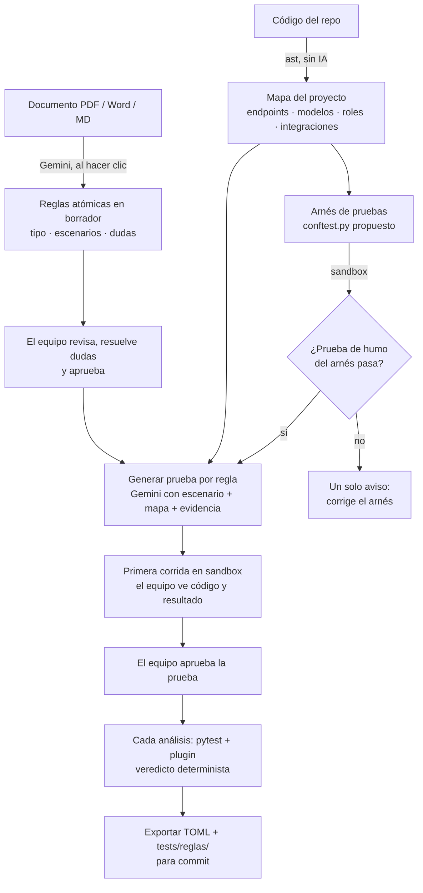

# Propuesta · Reglas de negocio verificables (v2)

- Estado: propuesta (para Sprint 9 en adelante)
- Fecha: 21 de noviembre de 2026
- Reemplaza en parte: [PROPUESTA_REGLAS_NEGOCIO.md](PROPUESTA_REGLAS_NEGOCIO.md) (formato y niveles) y amplía
  [PLAN_IMPORTAR_REGLAS_DOCUMENTO.md](PLAN_IMPORTAR_REGLAS_DOCUMENTO.md)
- Relacionado: [ADR-001](adr/ADR-001-motor-determinista.md) · [ADR-002](adr/ADR-002-sandbox.md) ·
  [ADR-003](adr/ADR-003-reglas-de-negocio.md) · [ADR-004](adr/ADR-004-pruebas-generadas.md)

---

## 1. Resumen

Hoy IA voy **lee** las reglas de negocio de un documento (PDF, Word, Markdown), pero casi nunca puede **comprobar**
si el código las cumple. Las comprueba de dos formas:

- **Patrones (regex)**: sirven para lo que se ve en el texto del código («no usar `float(`»). Casi ninguna regla
  real es así.
- **Pruebas del equipo** marcadas con `@pytest.mark.regla("RN-001")`: funcionan, pero casi nadie las escribe.

Con un documento real de inventario (15 reglas, §3) el resultado actual sería **1 regla verificable por regex y
14 «sin verificar»**. La función existe pero no sirve en la práctica.

**Propuesta:** IA voy **genera las pruebas** a partir del documento y del código, el equipo las **revisa y aprueba**,
y el sandbox las **ejecuta** con el plugin de siempre. El veredicto sale de ejecutar la prueba, no de la IA.

> **La IA lee el documento y escribe la prueba; la prueba, al ejecutarse, decide.**

Esto respeta el ADR-001: la IA solo interviene al *generar*. Una prueba aprobada y guardada da el mismo resultado
en cada análisis del mismo commit, igual que Ruff o Bandit.

## 2. Objetivo y criterio de éxito

**Objetivo:** que un equipo con un backend en Python (un CRUD o un servicio que atiende clientes) y su documento
de requisitos pueda, en menos de una hora y sin escribir TOML ni pruebas desde cero:

1. sacar las reglas del documento,
2. aprobarlas,
3. obtener una prueba ejecutable por regla,
4. ver en el reporte qué reglas cumple el código y cuáles no, con evidencia.

**Criterios de éxito**, medidos sobre el repo demo de inventario (§11.1):

| Métrica | Meta |
|---|---|
| Reglas del documento extraídas como reglas atómicas correctas | ≥ 90 % (las 15 de §3 producen 18 atómicas, más 1 de proceso) |
| Dudas reales del documento detectadas (PEPS vs. FEFO, «alerta/bloqueo»…) | ≥ 5 de las 7 sembradas |
| Reglas con prueba generada que se aprueba sin editar o con una edición pequeña | ≥ 80 % |
| Reglas rotas a propósito que salen «no cumple» | 5 de 5 |
| Reglas que salen «no cumple» con una prueba aprobada cuando el código sí cumple (falso positivo) | 0 |
| Pruebas «rotas» (fallan por el arnés o por la prueba, no por el código) en la primera generación | ≤ 20 %, y bajan a 0 tras corregir el arnés |

## 3. El caso que debe funcionar

Documento de requisitos de un inventario (cafetería o tienda):

1. No se borra físicamente (`DELETE`) un producto con historial; pasa a estado `Inactivo` (*soft delete*).
2. SKU, código de barras y nombre interno son únicos.
3. La unidad de medida base no se edita si el producto ya tiene movimientos.
4. El stock físico nunca es menor a `0`; se bloquean las ventas sin existencias.
5. `stock_actual` no se edita directamente: todo cambio pasa por un movimiento auditado (Kardex).
6. Los lotes y caducidades se manejan con PEPS (primeras entradas, primeras salidas).
7. Al cruzar el `stock_minimo` hay una alerta automática y un estado de reabastecimiento.
8. Hay productos de reventa (1 a 1) y compuestos por receta (descuento proporcional de insumos).
9. Las unidades de compra (cajas, costales) se convierten automáticamente a unidades de consumo (gramos, mililitros).
10. Las mermas tienen un flujo propio: descuentan stock sin sumar ingresos.
11. `precio_venta > 0`, y hay alerta o bloqueo si el precio es menor al `costo_unitario`.
12. El costo promedio ponderado se recalcula al registrar compras con nuevos precios.
13. En el catálogo se separan el precio base y los impuestos (IVA, IEPS).
14. Los permisos están separados por rol (cajero o barista vs. gerente o almacenista).
15. Hay una bitácora obligatoria (usuario, fecha, valor anterior y valor nuevo) para cambios de precio, costo y
    ajustes manuales.

Ninguna se puede verificar bien con regex. **Todas** se pueden verificar con un escenario ejecutable: preparar
datos, llamar a la API y comprobar el resultado. La tabla de §6.4 muestra cómo.

Lo mismo vale para servicios que atienden clientes (reservas, pedidos, soporte, pagos): «no se reserva dos veces el
mismo horario», «cancelar con menos de 24 h no da reembolso», «al confirmar el pedido se envía un correo», «un
cliente no ve los pedidos de otro». Para esas reglas también hay que controlar la hora y sustituir el correo, el SMS
y los pagos por versiones falsas (§7.3).

## 4. Qué se quita, qué cambia y qué se queda

### 4.1 Se quita

| Qué | Por qué |
|---|---|
| Campo `ia = true` | Se valida en el archivo pero ningún código lo usa. Lo reemplaza la evidencia de apoyo (§8), que existe para todas las reglas |
| `obligatorio` (regex que debe aparecer en **cada** archivo de `rutas`) | Su significado es raro y da falsos positivos (un `__init__.py` vacío lo incumple). Lo que buscaba («toda ruta de admin exige permiso») se verifica mejor con una prueba de permisos (§6.3). Se sigue aceptando por compatibilidad, con aviso de obsoleto; se quita de la plantilla y de la documentación principal |
| Escribir el TOML a mano como camino principal | El TOML queda como formato de guardado y de exportación; se edita desde una tabla |
| `# Fuente:` como comentario | Pasa a ser el campo `fuente` (§5) |
| Detectar documentos **solo** por el nombre | Se mantiene como sugerencia, pero también se puede elegir cualquier `.pdf`, `.docx` o `.md` del repo, o subir uno |

### 4.2 Cambia

| Qué | Antes | Ahora |
|---|---|---|
| Criterio de aceptación | `criterio`: texto libre, opcional | `[[regla.escenario]]` con `dado`, `cuando` y `entonces`. Es el puente entre el documento y la prueba. `criterio` se sigue aceptando y se lee como un escenario |
| Importador | Una regla por idea del documento | Separa las reglas compuestas en **reglas atómicas** (una comprobación cada una), las clasifica por `tipo` y escribe escenarios con datos concretos |
| Contradicciones del documento | Solo se detectaban entre regex (`prohibido` vs. `obligatorio`), que lo importado no tiene | **Hecho:** el importador marca los pares con `# CONTRADICCIÓN RN-a RN-b: …` y el archivo no es válido hasta dejar una ([PLAN_IMPORTAR_REGLAS_DOCUMENTO.md §5.5](PLAN_IMPORTAR_REGLAS_DOCUMENTO.md)). Una excepción para otro caso no cuenta |
| Estado de la regla | No existía | `estado = "borrador"` o `"aprobada"`. Solo las aprobadas cuentan en el reporte y en el score |
| Resultado por regla | cumple / no cumple / sin verificar | cumple / no cumple / **no implementada** / **prueba rota** / sin verificar / **fuera del código** (§9) |
| Origen de las pruebas | Solo las del equipo | Las del equipo **y** las generadas por IA voy y aprobadas en la app. Las del repo tienen prioridad |
| Plantilla | Ejemplos con regex | Ejemplos con escenarios; el regex aparece como opción avanzada |

### 4.3 Se queda

- `reglas_negocio.toml` en el repo (raíz o `docs/`) como fuente de verdad, con prioridad sobre lo cargado en la app.
- Los ids `RN-###`, el marcador `@pytest.mark.regla(...)`, el nombre `test_rn###_…` y el plugin `ia_voy_reglas`.
- El sandbox (WSL o Docker) para todo lo que ejecuta código del repo (ADR-002).
- La importación desde PDF o Word con sus dudas, la validación y los avisos de contradicciones y duplicados.
- `prohibido` (regex) como **opción avanzada** para lo que sí se ve en el texto («nada de `float(` en `pagos/`»,
  «nada de `DELETE FROM productos`»). No se genera automáticamente.
- El principio del ADR-001: la IA propone y la ejecución decide.

## 5. Formato `reglas_negocio.toml` v2

El archivo sigue siendo TOML. Los campos nuevos son opcionales, así que un archivo v1 válido sigue siendo válido.

```toml
[proyecto]
nombre  = "Inventario Cafetería"
version = "2.0"
formato = 2                                   # nuevo · opcional (1 si falta)

[[regla]]
id          = "RN-005"
titulo      = "El stock solo cambia con un movimiento"
descripcion = "stock_actual no se edita directamente; todo cambio pasa por un movimiento del Kardex."
severidad   = "alta"
tipo        = "flujo"                          # nuevo · datos | flujo | calculo | permisos | auditoria | integracion | proceso
estado      = "aprobada"                       # nuevo · borrador | aprobada
fuente      = "Requerimientos.docx · §4.2"     # nuevo · antes era comentario
historia    = "HU-12"
dudas       = []                               # nuevo · ambigüedades pendientes (no se puede aprobar con dudas abiertas)

  [[regla.escenario]]                          # nuevo · reemplaza a `criterio`
  dado     = "un producto con stock_actual = 10"
  cuando   = "un gerente envía PATCH /productos/{id} con stock_actual = 999"
  entonces = "stock_actual sigue en 10"

  [[regla.escenario]]
  dado     = "un producto con stock_actual = 10"
  cuando   = "se registra un movimiento de entrada de 5 unidades"
  entonces = "stock_actual es 15 y el Kardex tiene un movimiento con usuario, fecha, cantidad y saldo"

[[regla]]
id          = "RN-011"
titulo      = "Precio de venta menor al costo"
descripcion = "Si precio_venta < costo_unitario, el sistema lo bloquea."
severidad   = "media"
tipo        = "datos"
estado      = "borrador"
fuente      = "Requerimientos.docx · §5.1"
dudas       = ["El documento dice «alerta/bloqueo»: ¿se avisa y se permite, o se rechaza?"]

[[regla]]
id          = "RN-020"
titulo      = "El gerente revisa las mermas cada semana"
descripcion = "Cada lunes el gerente revisa y firma el reporte de mermas."
severidad   = "baja"
tipo        = "proceso"                        # fuera del código: no se verifica ni cuenta en el score
estado      = "aprobada"
```

| Campo | Obligatorio | Cambio | Notas |
|---|---|---|---|
| `id`, `titulo`, `descripcion`, `severidad` | sí | igual | — |
| `tipo` | no (se infiere al importar) | **nuevo** | Elige la plantilla de la prueba (§6.3). `proceso` = fuera del código |
| `estado` | no (`aprobada` si falta, por compatibilidad con v1) | **nuevo** | Lo importado entra como `borrador` |
| `fuente` | no | **nuevo** | Documento, página o sección |
| `dudas` | no | **nuevo** | Una regla con dudas abiertas no se puede aprobar desde la app. Con las reglas del repositorio, la app cambia `estado` y `dudas` en la copia de trabajo (con respaldo, como el editor) y avisa que hay que descargar el archivo y hacer commit: un análisis nuevo vuelve a clonar y el archivo del repo manda otra vez |
| `[[regla.escenario]]` | no | **nuevo** | `dado`, `cuando`, `entonces`; máximo 10 por regla |
| `criterio` | no | obsoleto | Se lee como un escenario |
| `historia`, `responsable` | no | igual | — |
| `rutas`, `prohibido` | no | igual (avanzado) | Solo para el nivel patrón |
| `obligatorio` | no | obsoleto | Se acepta y se muestra un aviso |
| `ia` | no | **se quita** | Se acepta y se ignora, con aviso |

**Pruebas que viven en el repo:** `tests/reglas/test_rn###_<nombre>.py` y `tests/reglas/conftest.py` (el arnés).
Cuando el equipo exporta, recibe el TOML y esta carpeta para hacer commit.

## 6. Cómo se verifica una regla

### 6.1 Flujo completo



### 6.2 Mapa del proyecto (determinista, sin IA)

Antes de generar nada, el backend lee el código con `ast` y arma un mapa. Sirve de contexto para la IA (para que no
invente endpoints ni campos) y para dar veredictos que no necesitan ejecutar nada.

| Qué | Cómo se obtiene | Para qué |
|---|---|---|
| Framework | Imports y dependencias (`fastapi`, `flask`, `django`/`rest_framework`) | Elegir el arnés (§7) |
| Endpoints | FastAPI: decoradores `@app.get`/`@router.post` y `include_router`; Flask: `@app.route`/`Blueprint`; DRF: `urls.py` + `ViewSet`/`APIView`. En FastAPI, además, `app.openapi()` dentro del sandbox, que es más exacto | Saber qué llamar en cada escenario; marcar «no implementada» si la acción no existe |
| Esquemas de entrada y salida | Modelos Pydantic, serializers de DRF | Saber qué campos acepta un PATCH (p. ej., si `stock_actual` es editable) |
| Modelos de datos | SQLAlchemy / SQLModel (`Column`, `mapped_column`, `unique=`, `CheckConstraint`), Django (`models.Model`, `unique=True`, `constraints`) | Crear datos de prueba; verificar reglas de esquema |
| Autenticación y roles | Dependencias de FastAPI (`Depends(get_current_user)`), decoradores (`@login_required`, `@requiere_rol`), permisos de DRF, enums o constantes de rol | Que el arnés pueda actuar «como cajero» |
| Integraciones externas | Imports de `smtplib`, `fastapi_mail`, `twilio`, `stripe`, `httpx`/`requests` hacia hosts externos, `celery` | Sustituirlas por versiones falsas en el arnés |
| Uso de la hora | `datetime.now`, `date.today`, `time.time` | Usar un reloj controlado en las reglas con plazos |

El mapa se guarda por commit y se muestra en la vista Reglas («IA voy encontró 23 endpoints, 9 modelos y 3 roles»).
Si el mapa está vacío (no hay framework reconocido), la app lo dice y solo ofrece el nivel patrón y las pruebas del
equipo (§10).

### 6.3 Pruebas generadas

Cada regla aprobada recibe **una prueba pytest por escenario**. Se generan en dos pasos (documento → escenario
estructurado → código), que según la literatura da mejores resultados que pasar directo del documento al código.
Gemini recibe:

- la regla (título, descripción, tipo) y sus escenarios,
- la parte del mapa que importa (endpoints, esquemas y modelos que menciona el escenario),
- los fixtures del arnés (§7), con sus firmas,
- hasta 6 fragmentos de código del índice RAG que ya existe, los que más se parecen a la regla.

Gemini devuelve JSON con esquema (igual que el importador): `{archivo, codigo, supuestos[]}`. El backend:

1. comprueba con `ast` que el código compila, que usa el marcador `@pytest.mark.regla("RN-###")`, que **no importa
   nada fuera de** `pytest`, el arnés, la librería estándar y el paquete del proyecto, y que no abre red ni archivos
   fuera de `tmp_path`,
2. lo guarda en `borrador` y lo corre una vez en el sandbox,
3. muestra al equipo el código, los supuestos («asumí que el endpoint de venta es `POST /ventas`») y el resultado.

**Regla de oro de las pruebas generadas:** el *Dado* se prepara con fixtures y helpers del arnés (`preparar(...)`),
y solo el *Entonces* usa `assert`. Así el plugin distingue «el código no cumple» de «la prueba no pudo preparar el
escenario» (§9).

Ejemplo (RN-005, primer escenario):

```python
import pytest


@pytest.mark.regla("RN-005")
def test_rn005_stock_no_se_edita_directo(como, crear_producto):
    p = crear_producto(stock_actual=10)                       # Dado (fixture del arnés)
    como("gerente").patch(f"/productos/{p['id']}", json={"stock_actual": 999})   # Cuando
    actual = como("gerente").get(f"/productos/{p['id']}").json()["stock_actual"]
    assert actual == 10, f"stock_actual cambió a {actual} sin un movimiento"     # Entonces
```

Plantillas por `tipo`, para que la IA no improvise la estructura:

| `tipo` | Forma de la prueba | Ejemplo |
|---|---|---|
| `datos` | Crear, intentar un valor inválido o duplicado, esperar un rechazo (4xx) y que no se guarde nada | SKU duplicado → 409/422 |
| `flujo` | Estado inicial → acción → estado final; intentar una transición prohibida | Producto con historial → DELETE → sigue existiendo como `Inactivo` |
| `calculo` | Datos con números exactos y resultado esperado exacto (`Decimal`, sin tolerancia salvo que el documento la dé) | 10 u a $10 + 10 u a $20 → costo promedio $15.00 |
| `permisos` | **Matriz rol × acción** parametrizada: cada celda espera 2xx o 403 | Cajero cambia precio → 403; gerente → 200 |
| `auditoria` | Acción → existe un registro con los campos exigidos y los valores anterior y nuevo | Cambiar precio → bitácora con usuario, fecha, $20 → $25 |
| `integracion` | Acción → la versión falsa (buzón, SMS, pasarela) registró el envío con los datos correctos | Confirmar pedido → 1 correo al cliente con el folio |
| `proceso` | No se genera prueba | — |

**Permisos:** los documentos casi nunca dan la matriz completa. Para las reglas de tipo `permisos`, la app arma con
el mapa una tabla editable (filas = acciones sensibles detectadas, columnas = roles detectados). El equipo marca
«permitido» o «prohibido» en cada celda, y la prueba se genera de forma determinista a partir de esa tabla, sin IA.

### 6.4 Las 15 reglas de §3

| # | Reglas atómicas | Tipo | Cómo la comprueba la prueba | Duda que debe salir al importar |
|---|---|---|---|---|
| 1 | RN-001 | flujo | Producto + movimiento → DELETE → GET sigue existiendo con `estado = Inactivo` | ¿Sin historial sí se puede borrar físicamente? |
| 2 | RN-002, RN-003, RN-004 (SKU, código de barras, nombre) | datos | Duplicar cada campo → 409/422 y un solo registro | ¿El nombre se compara sin distinguir mayúsculas ni espacios? |
| 3 | RN-005 | flujo | Con movimientos, PATCH de la unidad base → rechazo y la unidad no cambia | — |
| 4 | RN-006 | datos | Stock 3, venta de 5 → rechazo y el stock sigue en 3 | Concurrencia: fuera del alcance (§10.3) |
| 5 | RN-007 | flujo + auditoría | PATCH directo no cambia el stock; un movimiento sí, y queda en el Kardex | — |
| 6 | RN-008 | calculo | Lote A (entró antes) y lote B → la venta descuenta de A | **¿PEPS por fecha de entrada o por caducidad (FEFO)?** |
| 7 | RN-009 | flujo + integracion | Bajar al mínimo → estado `reabastecer` y alerta registrada | ¿«Cruzar» es `<` o `≤`? ¿Por qué canal llega la alerta? |
| 8 | RN-010 | calculo | Vender 1 producto con receta (200 ml de leche) → la leche baja 200 ml | ¿Qué pasa si falta un insumo? |
| 9 | RN-011 | calculo | Comprar 1 caja (factor 12) → el stock sube 12 | ¿Dónde se define el factor? |
| 10 | RN-012 | flujo | Merma de 2 → el stock baja 2 y los ingresos no cambian | — |
| 11 | RN-013 (`precio > 0`), RN-014 (precio < costo) | datos | Precio 0 → rechazo; precio < costo → según se resuelva la duda | **«alerta/bloqueo»: hay que elegir uno** |
| 12 | RN-015 | calculo | 10 u a $10, luego 10 u a $20 → costo $15.00 | ¿Cuántos decimales y cómo se redondea? |
| 13 | RN-016 | datos | La respuesta del catálogo trae `precio_base` e impuestos por separado | Faltan las tasas de IVA e IEPS |
| 14 | RN-017 | permisos | Matriz rol × acción (§6.3) | El documento no da la matriz completa |
| 15 | RN-018 | auditoria | Cambiar precio, costo o hacer un ajuste → registro con usuario, fecha, anterior y nuevo | — |

Total: 15 reglas del documento → 18 atómicas, todas verificables con escenario, con 7 dudas que se deben resolver
antes de aprobar.

### 6.6 Cómo quedó y qué se midió (fase 4)

- **Código:**
  - [reglas_pruebas.py](../backend/app/projects/reglas_pruebas.py): generación, validación, corrida y exportación.
  - [pruebas.py](../backend/app/projects/pruebas.py): endpoints `…/reglas/pruebas` (+ `/correr`, `/aprobar`, `/{rule_id}`) y
    `…/reglas/exportar`.
  - El plugin guarda el tipo de excepción (versión 2 de `reglas.json`).
  - Estados nuevos en [reglas.py](../backend/app/analyses/reglas.py) (`prueba_rota`, `no_implementada`,
    `fuera_del_codigo`, prioridad no cumple > rota > no implementada > sin verificar > cumple).
  - Sandbox:
    - modo `pruebas`;
    - en el análisis, segunda corrida sobre `tests/_ia_voy_reglas/` (`--ignore` en la del repo);
    - `reglas_app.json`, que se une a las del repo, con prioridad para el repo.
  - Tarjeta «Pruebas de las reglas» en Configuración. El reporte muestra los estados nuevos.
- **Funciona sin el formato v2 (fase 1):** con reglas v1, la IA elige el tipo y usa el `criterio` como escenario.
- **Lo que se aprendió con Gemini real.** Cada error se ataja en el prompt, en la validación o con una reparación sin IA:

  | Error de la IA | Cómo se ataja |
  |---|---|
  | Escribe `def_test_…` | Reparación automática |
  | Olvida los imports de `pytest` o `Decimal` | Se agregan solos |
  | Usa `preparar` sin pedirlo como fixture | Validación de nombres sin definir + una ronda de corrección |
  | Manda datos inválidos | Los esquemas van en el contexto |
  | Inventa fórmulas (impuestos) que la regla no da | Instrucción de comprobar solo lo que dice la regla |
  | Revisa el *Cuando* con `preparar` (convierte un «no cumple» en «prueba rota») | Instrucción |
  | Espera un solo código de rechazo | Instrucción + aviso |
  | Cuenta los correos de la preparación | Instrucción: `buzon.clear()` |
  | Prueba solo el caso idéntico en reglas de empalme | Instrucción: probar el traslape parcial y el límite exacto |
  | Usa `como(rol)` dos veces para «otro» usuario | Instrucción |
- **Medición** (una corrida por demo con el prompt final, en el sandbox WSL, sin las pruebas escritas a mano):

  | Métrica (§2) | Meta | `inventario_demo` | `reservas_demo` |
  |---|---|---|---|
  | Pruebas que se aprueban sin editar o con una edición pequeña | ≥ 80 % | 17/18 sin editar (RN-008 sale rota: manda fecha con hora a un campo de fecha) | 15/15 |
  | Reglas rotas a propósito que salen «no cumple» | 5 de 5 | 5/5 | 4/4 |
  | Falsos positivos con prueba aprobada | 0 | 0 | 0 |
  | Pruebas rotas en la primera generación | ≤ 20 % | 1/18 (6 %) | 0/15 |

  Las instrucciones se ajustaron mirando estos dos demos; falta medir con código ajeno (§11.2, pendiente de permiso).

### 6.5 Nivel patrón (se queda, avanzado)

`prohibido` con `rutas` sigue funcionando como hoy (`check_rule` en
[reglas.py](../backend/app/analyses/reglas.py)). Es útil para prohibiciones textuales como `float(` en dinero o
`DELETE FROM productos` en SQL crudo. Si una regla tiene prueba y patrón, cumple cuando se cumplen los dos.

## 7. El arnés de pruebas

Es lo más difícil de la propuesta: cada proyecto arma de forma distinta su base de datos y su autenticación. Por
eso el arnés se hace **una vez por proyecto**, se revisa aparte y se valida con una prueba de humo antes de generar
cualquier regla.

### 7.1 Qué ofrece

Un `tests/reglas/conftest.py` con fixtures de nombre fijo, para que todas las pruebas generadas se parezcan:

| Fixture | Qué hace |
|---|---|
| `api` | Cliente HTTP del framework, sin levantar servidor ni abrir puertos |
| `como(rol)` | El mismo cliente autenticado como un usuario de ese rol (se crea si no existe) |
| `crear_<modelo>(**campos)` | Crea datos de prueba, de preferencia **por la API** y, solo si la API no lo permite (p. ej., «producto con historial»), con el ORM |
| `preparar(condicion, motivo)` | Falla como **prueba rota** (no como «no cumple») si el *Dado* no se pudo preparar |
| `buzon`, `sms`, `pagos` | Versiones falsas de las integraciones; guardan lo que se «envió» |
| `reloj` | Hora controlada (`reloj.ir_a("2026-12-01 10:00")`) |
| Base de datos | SQLite temporal por prueba (o la base de pruebas de Django), con las tablas creadas desde los modelos |

### 7.2 Cómo se arma por framework

| Framework | Cliente | Autenticación | Base de datos |
|---|---|---|---|
| FastAPI | `fastapi.testclient.TestClient(app)` | `app.dependency_overrides[get_current_user] = lambda: usuario_con_rol` | Override de la dependencia de sesión (`get_db`) a SQLite temporal; `Base.metadata.create_all` |
| Flask | `app.test_client()` (con `create_app(config de pruebas)` si existe) | `flask_login.login_user` en un `test_request_context`, o el endpoint de login | `SQLALCHEMY_DATABASE_URI = sqlite:///…tmp` |
| Django / DRF | `rest_framework.test.APIClient` o `django.test.Client` | `force_authenticate` / `force_login`; roles como `Group` | Base de pruebas de `pytest-django` (`@pytest.mark.django_db`) |

La IA propone el arnés a partir del mapa (§6.2) y de los `conftest.py` que ya tenga el repo; si el repo ya tiene
un fixture de cliente, se reutiliza. El equipo lo revisa como cualquier otra prueba.

### 7.3 Integraciones y hora

- **Correo / SMS / push:** `monkeypatch` sobre la función del proyecto que envía (encontrada en el mapa), o
  sobre `smtplib.SMTP`. El fake guarda los mensajes en `buzon`.
- **HTTP a terceros (pasarelas, APIs):** [respx](https://github.com/lundberg/respx) (httpx) o
  [responses](https://github.com/getsentry/responses) (requests). Cualquier llamada no simulada **falla la prueba
  como rota**; nunca sale a internet.
- **Tareas en segundo plano:** Celery en modo *eager* (`task_always_eager = True`), o la llamada directa a la tarea.
- **Hora:** [time-machine](https://github.com/adamchainz/time-machine) (preferido, más rápido) o
  [freezegun](https://github.com/spulec/freezegun).

Estas librerías se instalan **solo dentro del sandbox**, en la fase `tests`, junto con el plugin. No se agregan
al proyecto del equipo salvo que exporte el arnés.

### 7.4 Prueba de humo

Antes de generar las reglas: crear un usuario de cada rol, llamar a un endpoint de lista con cada uno y crear un
registro de cada modelo principal. Si algo falla, la vista Reglas muestra **un solo aviso** con el error y el
fixture que lo causó («`crear_producto`: la API pidió `categoria_id`»). No se generan pruebas de reglas hasta que
el arnés pase.

### 7.5 Cómo quedó (fase 3)

- **Mapa** ([mapa.py](../backend/app/analyses/mapa.py)):
  - Qué lee:
    - FastAPI: routers anidados con `prefix`, `include_router` y alias `Annotated[..., Depends(...)]` importados.
    - Flask: blueprints importados, `register_blueprint(url_prefix=)` y la fábrica `create_app()`.
    - Django/DRF: `ROOT_URLCONF`, `include()`, `DefaultRouter`, viewsets con `@action` y vistas genéricas.
    - Roles: constantes `ROLES`, enums, `requiere("x")` / `requiere(*CONSTANTE)`, `usuario.rol == "x"` y grupos de Django.
    - Modelos: SQLAlchemy, SQLModel con `table=True`, Flask-SQLAlchemy y Django con bases abstractas.
    - Esquemas Pydantic y DRF, integraciones, usos de la hora, la base real (`engine`, `SessionLocal`) y los
      nombres de cada módulo.
  - Lee la sintaxis de Python 3.14 (`except A, B:`).
  - Probado con los dos demos y con `fastapi/full-stack-fastapi-template` (23 endpoints, 2 modelos),
    `miguelgrinberg/microblog` (35 endpoints con blueprints, 5 modelos) y `MSKose/django-stock-app` (31 endpoints DRF,
    5 modelos).
- **Arnés** ([reglas_arnes.py](../backend/app/projects/reglas_arnes.py)):
  - Lo propone Gemini o se toma el `conftest.py` del repo que ya define `api` y `como`.
  - IA voy pone `PreparacionFallida`, `preparar` y `Reloj`; la IA no los escribe.
  - La validación con `ast` revisa, sin ejecutar:
    - que estén los fixtures obligatorios y que solo importe lo permitido (biblioteca estándar, pytest, el
      framework, las dependencias y los paquetes del proyecto);
    - que no llame a `open`, `eval`, `subprocess` ni `os.system`;
    - que un fixture no tape algo importado (`def reloj` + `from reservas import reloj`);
    - que no use nombres que no existen en los módulos del proyecto (`db.select` cuando `reservas/db.py` no lo define);
    - y avisa si usa la base real.

  Los tres últimos salieron de arneses reales de Gemini que fallaban: ahora se detectan antes de correr.
- **Prueba de humo:**
  - El backend la arma con el mapa (`test_humo_api`, `test_humo_como[rol]`, `test_humo_crear[crear_x]` y
    `reloj` / `buzon`).
  - Corre en el sandbox (modo `arnes`: copia, `overlay` en `tests/_ia_voy_reglas/`, instalar y pytest, sin
    auditoría ni cobertura).
  - Si falla, da un solo aviso: «como('cajero'): GET /alertas respondió 401, el usuario no quedó autenticado».
- **Aprobación:** solo con la prueba de humo pasada sobre el mismo código (hash). Editarlo vuelve a pedirla.
- **Endpoints:**
  - `GET /api/projects/{id}/reglas/mapa`;
  - `GET|POST|PUT|DELETE …/reglas/arnes`;
  - `POST …/reglas/arnes/repo`, `…/arnes/humo` y `…/arnes/aprobar`.
- **Frontend:** tarjeta «Mapa y arnés de pruebas» en Configuración → Reglas de negocio.

### 7.6 Repos públicos con código ajeno (fase 3, Docker)

Se probó el flujo mapa → arnés con Gemini → prueba de humo en **Docker** (`SANDBOX=docker`, el aislamiento que piden
los repos ajenos) con 5 repos públicos, uno o más por framework. Solo se analizaron con la URL; el código no se copió.

| Repo (commit) | Framework | Mapa | Arnés | Prueba de humo |
|---|---|---|---|---|
| Ad-pkh/Clinic-Management-API (`8466a04`) | FastAPI | 22 endpoints, 4 modelos | válido a la 2.ª | **pasa** (4 comprobaciones) |
| miguelgrinberg/microblog (`a975ef6`) | Flask | 35 endpoints, 5 modelos | válido | **pasa** (7 comprobaciones; necesita la imagen con compilador) |
| NewGenesis04/InventoryFlow (`b735d65`) | FastAPI | 37 endpoints, 4 roles | válido | falla: `email-validator` no está en sus dependencias |
| eugen-goebel/inventory-management (`8f44513`) | FastAPI | 20 endpoints, 3 roles | válido a la 3.ª (con la raíz del código) | **pasa** (7 comprobaciones, 3 roles) |
| MSKose/django-stock-app (`cf6f7af`) | Django/DRF | 31 endpoints, 5 modelos | válido | falla: sus dependencias de 2022 no instalan en Python 3.12 |

**Resultado:** 3 de 5 pasan de punta a punta (FastAPI ×2 y Flask). El mapa fue correcto en los 5.
Lo que salió y cómo se resolvió:

- **Faltaba `import pytest` en un arnés** (microblog, `NameError`). Ahora IA voy agrega los imports que el arnés usa sin
  importar (`pytest`, `Decimal`, `datetime`…), como ya hacía con las pruebas.
- **El arnés no sabía las variables de entorno** (InventoryFlow lee `DB_URL`; Gemini puso `DATABASE_URL`). El prompt
  ahora incluye el `.env.example` (solo la plantilla; el `.env` nunca se lee) y pide usar sus nombres exactos con
  `os.environ.setdefault(...)` antes de importar la app. Con eso el arnés pasó a fallar por otra cosa.
- **Dependencias en `pyproject.toml` que `requirements.txt` no trae** (InventoryFlow: `python-dotenv`). El sandbox
  instala también las de `[project].dependencies`.
- **Código en una subcarpeta** (eugen: todo en `backend/`). El validador veía `agents.auth_service` como un módulo que
  no existe, porque el mapa nombraba los módulos desde la raíz del repo (`backend.agents…`). Ahora el mapa detecta la
  **raíz del código** (`mapa.source_root`): si la raíz no tiene `requirements.txt`, `pyproject.toml` ni parecidos y
  exactamente una carpeta de primer nivel sí, los módulos se nombran desde ahí; las rutas del mapa siguen siendo las del
  repo. El sandbox, en todos sus modos (también el análisis normal de pytest y cobertura), instala y corre desde esa carpeta
  y escribe cuál fue en `subdir`; los archivos de junit, coverage y reglas.json salen con la carpeta antepuesta
  (`backend/tests/…`), así que los hallazgos, la cobertura y los enlaces al editor usan rutas del repo. La prueba de
  fuerza sigue escribiendo los mutantes con rutas del repo (`IA_VOY_RAIZ`). Medido con eugen-goebel en Docker: el
  análisis normal pasó de no poder importar nada a 105 pruebas que pasan y 30 archivos con cobertura. Las dependencias y el `.env.example` también se leen de ahí.
- **Nombres sin importar** (`os`, `Callable`: `NameError` al cargar el arnés, en Clinic-Management-API y microblog). Se
  agregan los imports conocidos y la validación avisa de los demás (`undefined_names`), así que la ronda de corrección
  los recibe.
- **Avisos de instalación con la causa probable:** sin compilador en la imagen de Docker (sugiere
  `SANDBOX_DOCKER_IMAGE=…bookworm`) o una dependencia fijada que no se compila con Python 3.12.
- **Scripts de medición** en `backend/scripts/` (`medir_demos.py` y `medir_repo_publico.py`).
- **Arneses con error de sintaxis o imports inventados.** `generate` valida el arnés y, si falla, se lo devuelve a la IA
  una vez con los errores (como ya hacían las pruebas).
- **La imagen `-slim` de Docker no trae compilador.** Con dependencias antiguas que se compilan (microblog), la
  instalación falla. Con `SANDBOX_DOCKER_IMAGE=ghcr.io/astral-sh/uv:python3.12-bookworm` (1.5 GB, con `gcc`) pasa. El
  valor por defecto sigue siendo la `-slim` (261 MB): para repos ajenos conviene la completa.

Límites que **no** se resolvieron (quedan como casos de §10.2):

- **Más de una carpeta con código** (`api/` y `worker/`): se elige la única que declara un framework web (FastAPI, Flask
  o Django) en sus dependencias; si siguen siendo varias, ninguna y se trabaja desde la raíz.
- **Pruebas en otra carpeta** (`tests/` en la raíz y el código en `backend/`): el análisis corre pytest desde la carpeta
  del código, así que no ve las pruebas de la raíz.
- **Dependencias que el repo no declara** o **fijadas a versiones que no instalan** en Python 3.12 (django-stock-app):
  el arnés no puede arreglarlo; se avisa con el error de la instalación.
- Gemini 3.5 Flash Lite a veces devuelve un arnés con error de sintaxis o con imports inventados (4 de los 8 primeros
  intentos de esta prueba). Con la ronda de corrección el arnés de eugen-goebel salió válido a la tercera.

## 8. Evidencia de apoyo (IA, no cuenta)

Para cada regla, la vista Reglas muestra **dónde parece estar implementada**: el índice RAG busca con el texto de
la regla y Gemini elige las líneas y da una lectura: «parece implementada», «parcial» o «no encontrada», con
`archivo:línea`. Sirve para entender el resultado y para corregir la prueba, pero **no cambia el estado ni el score**.
Se guarda por commit y regla, y solo se pide al hacer clic o al generar la prueba.

## 9. Estados de una regla en el reporte

| Estado | Cuándo | ¿Cuenta en el score? |
|---|---|---|
| **cumple** | Todas sus pruebas aprobadas pasan (y su patrón, si tiene) | Sí, a favor |
| **no cumple** | Una prueba aprobada falla en un `assert` del *Entonces*, o el patrón aparece | Sí, en contra, con la severidad de la regla |
| **no implementada** | La acción del *Cuando* no existe en el mapa (no hay endpoint para registrar mermas). Se sabe sin ejecutar | Sí, en contra |
| **prueba rota** | Falla el arnés, `preparar(...)`, un import o cualquier excepción que no sea un `assert` de la prueba | No: se le pide al equipo revisar la prueba. **No se culpa al código** |
| **sin verificar** | Aprobada pero sin prueba aprobada ni patrón, o sin sandbox | No, pero se muestra como pendiente |
| **fuera del código** | `tipo = "proceso"` | No; no entra al denominador |
| (borrador) | `estado = "borrador"` | No se muestra en el reporte; solo en Configuración |

El plugin `ia_voy_reglas` ya ve cada resultado de pytest. Solo se agrega la clasificación:
`AssertionError` dentro del cuerpo de la prueba = no cumple; error en un fixture o en `preparar`, o cualquier otra
excepción = prueba rota. Un 500 del servidor, si el escenario esperaba 2xx o 4xx, cuenta como **no cumple** (el
código falló), porque llega como una respuesta y se revisa con `assert`. Para eso el arnés crea los clientes sin
propagar las excepciones del servidor (`TestClient(app, raise_server_exceptions=False)` en FastAPI,
`PROPAGATE_EXCEPTIONS = False` en Flask, `raise_request_exception=False` en Django).

**Score (fase 6, hecho):** la categoría `neg` se calcula solo con reglas aprobadas **que tienen una prueba aprobada
o un patrón**, ponderadas por severidad (alta 3, media 2, baja 1): `100 × peso de las que cumplen / peso de las que
se midieron` (cumple, no cumple, no implementada). Prueba rota, sin verificar y fuera del código no entran. Pesa
**0 % por defecto**: se muestra en el reporte y solo mueve el global cuando el proyecto le da un peso
(`[pesos] negocio`). Si el análisis no tiene reglas medibles, `neg` no existe y su peso no cuenta. Detalle y fórmula
en [CRITERIOS_DE_ANALISIS.md](CRITERIOS_DE_ANALISIS.md) §2.

## 10. Alcance: en qué repositorios funciona

### 10.1 Funciona (objetivo)

| Condición | Detalle |
|---|---|
| Lenguaje | Python 3.10+ (lo único que analiza IA voy, [languages.py](../backend/app/analysis/languages.py)) |
| Tipo de proyecto | Backend con API HTTP: **CRUD** (inventarios, catálogos, escolares, clínicas) y **servicios que atienden clientes** (pedidos, reservas, citas, soporte, suscripciones, pagos) |
| Framework | **FastAPI**, **Flask** o **Django / DRF** |
| Datos | SQLAlchemy 1.4/2.x, SQLModel o Django ORM, con un esquema que funcione en SQLite |
| Dependencias | `requirements.txt` o `pyproject.toml` que el sandbox pueda instalar (lo mismo que se pide hoy para pytest) |
| Autenticación | Por dependencia, decorador o sesión que se pueda sustituir en pruebas (lo normal en los tres frameworks) |
| Documento | PDF (con texto o escaneado), `.docx`, `.md` o `.txt` de hasta 10 MB, en español o inglés |

### 10.2 Funciona en parte (con avisos)

| Caso | Qué pasa |
|---|---|
| Paquete de dominio sin API (solo funciones o clases) | Se generan pruebas unitarias que llaman a las funciones; los tipos `permisos` e `integracion` quedan «sin verificar» |
| Código en subcarpeta (`backend/`, `src/`) | Funciona (§7.6): se detecta la carpeta con `requirements.txt`/`pyproject.toml` (o la única que declara un framework web) y el análisis, las pruebas de reglas y el mapa trabajan desde ahí. No ve las pruebas que estén fuera de esa carpeta |
| PostgreSQL con funciones propias (JSONB, `ARRAY`, triggers, `CHECK` solo en migraciones SQL) | En SQLite pueden fallar o comportarse distinto → prueba rota con el motivo. A futuro: un servicio PostgreSQL efímero en Docker |
| SQLAlchemy async | Funciona con `TestClient`; el arnés usa `aiosqlite` |
| GraphQL (Strawberry, Graphene) | El cliente envía consultas; el mapa no lee el esquema, así que la IA recibe menos contexto |
| Reglas que viven en triggers o procedimientos de la base | Solo si el esquema se puede crear en SQLite; si no, «sin verificar» |
| Autenticación externa (OAuth de Google, Auth0, Keycloak) | Se sustituye el usuario actual; no se prueba el login real |

### 10.3 Excluido (no se intenta)

| Qué | Por qué | Cómo se muestra |
|---|---|---|
| Lenguajes que no son Python (Node, Java, PHP, .NET…) | IA voy no los analiza. A futuro: pruebas HTTP de caja negra contra docker-compose (§14) | El análisis ya avisa |
| Reglas que solo viven en el frontend o en la interfaz («el botón se deshabilita») | No hay navegador en el sandbox | «fuera del código» si el importador las detecta |
| Procesos humanos u organizacionales («el gerente firma cada lunes») | No están en el código | `tipo = "proceso"` |
| Rendimiento, disponibilidad y SLAs («responde en < 200 ms») | Medirlo en un sandbox compartido no es confiable | «fuera del código» |
| Concurrencia y condiciones de carrera («dos ventas simultáneas no dejan stock negativo») | Las pruebas no serían deterministas | Se avisa como duda; se prueba solo la versión secuencial |
| Comportamiento de un LLM o chatbot del proyecto | Su salida no es determinista | «fuera del código» |
| Llamadas reales a servicios externos (pagos, SAT, correo) | El sandbox no sale a internet y no debe cobrar ni enviar nada | Siempre con fakes |
| Microservicios que necesitan otros servicios vivos | No se levantan varios servicios | «sin verificar» con el motivo |
| Si las reglas cumplen la ley (fiscal, protección de datos) | IA voy verifica que el código haga lo que dice el documento, no que el documento sea legal | — |
| Generar pruebas de cobertura o regresión «para subir el porcentaje» | Es otro objetivo (§12.2) | — |
| Pentesting o fuzzing de seguridad | Lo cubren Bandit y pip-audit; no es una regla de negocio | — |

## 11. Repositorios para probarlo

### 11.1 Repos demo propios (los creamos nosotros; son la prueba de aceptación)

| Repo | Contenido | Qué debe salir |
|---|---|---|
| `seed_data/inventario_demo/` (**hecho**, ver su [ESPERADO.md](../backend/seed_data/inventario_demo_clave/referencia/ESPERADO.md)) | FastAPI + SQLAlchemy + SQLite, roles cajero, barista, gerente y almacenista, Kardex, lotes y recetas. `docs/Requerimientos.docx` con las 15 reglas de §3, 1 regla de proceso y 7 ambigüedades a propósito. **5 reglas rotas a propósito**: stock negativo en ventas, DELETE físico, cajero que cambia precios y costos, costo promedio simple en lugar de ponderado y bitácora sin valor anterior | 18 reglas atómicas + 1 de proceso, ≥ 5 de 7 dudas, 13 cumple y 5 no cumple, 0 pruebas rotas tras aprobar el arnés |
| `seed_data/reservas_demo/` (**hecho**, ver su [ESPERADO.md](../backend/seed_data/reservas_demo_clave/referencia/ESPERADO.md)) | Flask + SQLAlchemy: clientes, citas, anticipo, cancelaciones con reembolso, premium, correos, recordatorios y bloqueo tras 3 intentos. `docs/Requisitos.pdf` con **2 contradicciones** entre áreas, 1 excepción que no es contradicción, 1 regla repetida con otras palabras y 3 dudas. **4 reglas rotas**: empalme del profesional, 24 h exactas, IDOR al ver una cita, bloqueo en el 4.º intento | 15 reglas (+2 de finanzas que se descartan al resolver), contradicciones 1 y 2 marcadas sin marcar la excepción, 11 cumple y 4 no cumple. Reglas con `reloj`, `buzon` y matriz de permisos |
| `seed_data/demo_repo/` (ya existe, pagos) | Se actualiza al formato v2 | Debe seguir dando el mismo resultado que hoy (prueba de compatibilidad) |

Los demo son código nuestro: los podemos modificar, versionar y usar en las pruebas automáticas (pytest del backend
con un LLM falso y una corrida real marcada `@pytest.mark.gemini`).

### 11.2 Repos públicos para probar con código ajeno

Igual que en [repos-de-prueba.md](repos-de-prueba.md): **solo se analizan con la URL; no se copia su código**.
Antes de agregarlos al conjunto estándar hay que fijar la rama y el commit y revisar la licencia y si las pruebas
corren en el sandbox.

| Repo | Stack | Para qué sirve | Estado |
|---|---|---|---|
| [fastapi/full-stack-fastapi-template](https://github.com/fastapi/full-stack-fastapi-template) | FastAPI + SQLModel + pytest, superusuario y usuarios normales | Probar el arnés con autenticación JWT real y un `conftest.py` existente que se debe reutilizar | Conocido y mantenido; necesita PostgreSQL (caso §10.2) |
| [eugen-goebel/inventory-management](https://github.com/eugen-goebel/inventory-management) | FastAPI + SQLite + pytest, movimientos de stock con historial | El más parecido al caso de §3 con código ajeno | **Probado** (`8f44513`, MIT): mapa bien (20 endpoints, 3 roles); arnés válido y **prueba de humo pasa** (7 comprobaciones) con la raíz del código en `backend/` (§7.6) |
| [Denxhinjo/IMS_Clean](https://github.com/Denxhinjo/IMS_Clean) | FastAPI + SQLAlchemy 2 + Alembic, endpoints de movimientos de stock | Inventario con PostgreSQL: probar los avisos de §10.2 | Por revisar |
| [NewGenesis04/InventoryFlow](https://github.com/NewGenesis04/InventoryFlow) | FastAPI + SQLAlchemy async | Probar el arnés async | **Probado** (`b735d65`, MIT): mapa bien (37 endpoints, 4 roles); arnés válido, pero la prueba de humo falla: el repo no declara `email-validator` (§7.6) |
| [MSKose/django-stock-app](https://github.com/MSKose/django-stock-app) | Django REST Framework | Arnés de Django / DRF | **Probado** (`cf6f7af`, sin licencia): mapa bien (31 endpoints DRF); el arnés es válido, pero sus dependencias de 2022 no se instalan en Python 3.12 (`ruamel-yaml-clib==0.2.6`) (§7.6) |
| [Ad-pkh/Clinic-Management-API](https://github.com/Ad-pkh/Clinic-Management-API) | FastAPI + pytest + SQLite en memoria; citas con conflictos de horario | Servicio con clientes: «no hay dos citas a la misma hora» | **Probado** (`8466a04`, sin licencia): arnés válido a la segunda y **prueba de humo pasa** (4 comprobaciones, FastAPI, Docker) |
| [thunderbird/appointment](https://github.com/thunderbird/appointment) | FastAPI + SQLAlchemy + pytest (backend de citas real) | Servicio con clientes grande y real; reglas de agenda y correos | Conocido; probablemente demasiado grande para el sandbox |
| [Pytest-with-Eric/pytest-fastapi-crud-example](https://github.com/Pytest-with-Eric/pytest-fastapi-crud-example) | FastAPI + SQLite + pytest | Ya está en el conjunto estándar: CRUD sin roles, para el caso mínimo | Ya usado |
| [inventree/InvenTree](https://github.com/inventree/InvenTree) | Django, inventario de producción | Prueba de escala: cuánto tarda el mapa y si la IA se pierde en un repo grande | Conocido; solo como prueba de límites |

«Por revisar» = salió en la búsqueda del 21 nov 2026 pero no se ha clonado ni corrido; puede no tener licencia o no
instalar en el sandbox.

## 12. Herramientas y proyectos de referencia

### 12.1 Que usaremos (dentro del sandbox, en la fase `tests`)

| Herramienta | Uso |
|---|---|
| [pytest](https://github.com/pytest-dev/pytest) + plugin `ia_voy_reglas` (existe) | Ejecutar y clasificar |
| [time-machine](https://github.com/adamchainz/time-machine) / [freezegun](https://github.com/spulec/freezegun) | `reloj` |
| [respx](https://github.com/lundberg/respx) / [responses](https://github.com/getsentry/responses) | Bloquear y simular HTTP a terceros |
| [pytest-django](https://github.com/pytest-dev/pytest-django) | Base de pruebas en proyectos Django |
| `aiosqlite` | SQLAlchemy async sobre SQLite |

### 12.2 Que estudiamos pero no adoptamos tal cual

| Proyecto | Qué hace | Qué tomamos | Por qué no se adopta tal cual |
|---|---|---|---|
| [qodo-ai/qodo-cover](https://github.com/qodo-ai/qodo-cover) (antes Cover-Agent, basado en TestGen-LLM de Meta) | Genera pruebas con LLM, las corre y solo **conserva las que pasan** y suben la cobertura | El ciclo generar → correr → mostrar resultado; las métricas de Meta (75 % compilan, 57 % pasan) para calibrar la meta de §2 | Conserva solo las que pasan: para reglas de negocio, una prueba que falla puede ser **la evidencia** de que el código no cumple. Nuestro filtro es «rota vs. falla en el `assert`», no «pasa o se descarta» |
| [se2p/pynguin](https://github.com/se2p/pynguin) | Genera pruebas unitarias de Python automáticamente | — | Toma lo que el código hace hoy como lo correcto (oráculo de regresión): convertiría los bugs en «esperado». **El oráculo debe salir del documento, no del código** |
| [WebFuzzing/EvoMaster](https://github.com/WebFuzzing/EvoMaster) | Genera pruebas de API REST desde OpenAPI (salida en Python) | La idea de usar el esquema OpenAPI como mapa de la API | Mismo problema de oráculo; además pide JVM y su modo de caja blanca es para Java |
| [schemathesis/schemathesis](https://github.com/schemathesis/schemathesis) | Pruebas de propiedades contra OpenAPI (pruebas con estado vía *links*) | Posible verificación genérica a futuro («ningún endpoint da 500») | No conoce las reglas del negocio; es robustez, no reglas |
| [pytest-dev/pytest-bdd](https://github.com/pytest-dev/pytest-bdd) | Gherkin (`.feature`) sobre pytest | El formato *Dado / Cuando / Entonces* como paso intermedio | Obligaría a mantener `.feature` + *steps* además del TOML; los escenarios viven en el TOML y la prueba es pytest simple |
| [boxed/mutmut](https://github.com/boxed/mutmut) / [sixty-north/cosmic-ray](https://github.com/sixty-north/cosmic-ray) | Pruebas de mutación | **Prueba de fuerza** (fase 5): mutar las líneas que señala la evidencia y comprobar que la prueba de la regla falla. Si sigue pasando, la prueba es débil | Correr mutación completa es lento; solo se usa dirigida y al aprobar |
| [docling-project/docling](https://github.com/docling-project/docling) / [microsoft/markitdown](https://github.com/microsoft/markitdown) | PDF y Word → Markdown | Si las tablas de los `.docx` llegan mal con el lector actual (`zipfile`), usar `markitdown[docx]`, que es ligero | Docling es pesado (modelos de layout y OCR). El PDF ya va directo a Gemini, que lee texto y escaneos |
| [TestLoom](https://saurabh-oss.github.io/testloom/) y [usecase-to-testcase](https://github.com/navidh86/usecase-to-testcase) | Casos de prueba desde historias de usuario o casos de uso | Ideas de prompt y de estructura del escenario | Generan casos de prueba en texto, JSON o CSV, no pruebas ejecutables ligadas al código |

Literatura que respalda dos decisiones:

- Generar en dos pasos (requisito → escenario estructurado → código) da mejores resultados que pasar directo del
  requisito al código ([arXiv 2406.07021](https://arxiv.org/abs/2406.07021v1) y trabajos relacionados).
- Generar pruebas de API REST ejecutables (pytest) desde requisitos en lenguaje natural más el esquema OpenAPI es
  viable con LLMs ([arXiv 2506.06509](https://arxiv.org/abs/2506.06509)).

## 13. Cambios en el código

| Archivo | Cambio |
|---|---|
| [backend/app/analyses/reglas.py](../backend/app/analyses/reglas.py) | Formato v2: `tipo`, `estado`, `fuente`, `dudas` y `[[regla.escenario]]`; `criterio` → escenario; avisos de obsoleto para `obligatorio` e `ia`; estados nuevos en `combine`; filtrar borradores; plantilla nueva |
| [backend/app/projects/reglas_importar.py](../backend/app/projects/reglas_importar.py) | Esquema JSON nuevo (reglas atómicas, `tipo`, escenarios, dudas por regla); el prompt pide separar las reglas compuestas y marcar `proceso` |
| `backend/app/analyses/mapa.py` (nuevo) | Mapa del proyecto con `ast` (§6.2); `app.openapi()` en el sandbox para FastAPI |
| `backend/app/projects/reglas_pruebas.py` (nuevo) | Generar el arnés y las pruebas con Gemini; validación con `ast` (imports permitidos, marcador, nada de red); matriz de permisos → pruebas sin IA |
| [backend/app/analysis/ia_voy_reglas.py](../backend/app/analysis/ia_voy_reglas.py) | Clasificar «no cumple» vs. «prueba rota» |
| [backend/app/analysis/sandbox.py](../backend/app/analysis/sandbox.py) | Copiar las pruebas aprobadas de la app a `tests/_ia_voy_reglas/` en la copia temporal (salvo que el repo traiga `tests/reglas/`); instalar `time-machine`, `respx`, `responses`, `aiosqlite` y, en Django, `pytest-django` junto al plugin |
| [backend/app/analyses/reglas_store.py](../backend/app/analyses/reglas_store.py) + migración | Tablas `business_rule_tests` (repo, regla, hash de la regla, código, estado, modelo, commit) y `business_rule_harness`; mapa por commit |
| Endpoints | Arnés (hecho, §7.5): `…/reglas/mapa`, `…/reglas/arnes` (+ `/repo`, `/humo`, `/aprobar`). Pruebas (hecho, §6.6): `…/reglas/pruebas` (+ `/correr`, `/aprobar`, `/{rule_id}`) y `…/reglas/exportar`. Fase 5 (hecho, §14.1): `…/pruebas/{rule_id}/matriz`, `…/pruebas/{rule_id}/evidencia` y `…/pruebas/fuerza` |
| Frontend `features/rules` | Tabla de reglas con estado y dudas; vista de prueba (código, supuestos, último resultado); editor de la matriz de permisos; aviso del arnés; exportar |
| `docs/adr/ADR-004-pruebas-generadas.md` (nuevo) | Deja constancia de que la IA genera pruebas, que solo cuentan las aprobadas y que el veredicto sale de ejecutarlas |

**Costo de Gemini:** solo al hacer clic (importar, generar el arnés, generar o regenerar una prueba, pedir
evidencia). Para 18 reglas: 1 llamada de importación + 1 de arnés + 18 de pruebas, unos 2–4 minutos en total. Cada
resultado se guarda por hash de la regla y commit; el análisis **nunca** llama a la IA.

## 14. Fases

| Fase | Entrega | Criterio de aceptación |
|---|---|---|
| **1 · Importador v2** (**hecho**; la tabla de aprobación está en Configuración → Reglas de negocio) | Formato v2, reglas atómicas, `tipo`, escenarios, `estado` y `dudas`; tabla de aprobación | Con el `.docx` del inventario: 18 reglas, ≥ 5 de las 7 dudas; un TOML v1 sigue validando |
| **2 · Repos demo** (**hecho**) | `inventario_demo` y `reservas_demo` con sus documentos, pruebas manuales de referencia y tabla de resultados esperados | Con las pruebas **escritas a mano** y el plugin actual, el reporte da 13/5 (inventario) y 11/4 (reservas) ([test_demos_reglas.py](../backend/tests/test_demos_reglas.py)). Es la referencia para todo lo que sigue |
| **3 · Mapa y arnés** (**hecho**; repos públicos en §7.6) | `mapa.py`, generación y prueba de humo del arnés para FastAPI, Flask y Django | El arnés del demo pasa la prueba de humo sin editarlo, o con una edición; los 3 frameworks probados con un repo público cada uno (§7.6). **Resultado** (§7.5): con Gemini real, el arnés de los dos demos pasa la prueba de humo en el sandbox WSL sin editarlo (7 y 10 comprobaciones). El mapa se probó con 3 repos públicos (FastAPI, Flask, Django); el arnés y la prueba de humo en repos públicos se probaron en Docker (§7.6): pasan FastAPI y Flask; Django no instala sus dependencias de 2022 |
| **4 · Pruebas generadas** (**hecho**, §6.6) | Generación por tipo, validación con `ast`, primera corrida, aprobación, estados nuevos y exportación | Las metas de §2 sobre `inventario_demo`. **Resultado** con Gemini 3.5 Flash Lite: 17 de 18 sin editar, 5 de 5 rotas detectadas, 0 falsos positivos tras aprobar y 1 prueba rota (6 %). En `reservas_demo`: 15 de 15 y 4 de 4 rotas detectadas |
| **5 · Servicios con clientes y calidad** (**hecho**, §14.1) | `reloj`, `buzon`, `respx`, matriz de permisos, evidencia de apoyo, prueba de fuerza con mutación dirigida | `reservas_demo` completo; la prueba de fuerza detecta al menos 1 prueba débil sembrada. **Resultado** (Gemini real y sandbox WSL): la prueba débil sembrada sale «débil» (0 de 3 cambios) y la buena «fuerte» (3 de 3); la matriz del equipo da «cumple» en RN-015 y detecta un permiso de más; la evidencia señala 7 de 9 errores sembrados; de las pruebas buenas, 16 salen fuertes, 6 parciales (huecos reales) y 1 débil (falsa alarma). **Segunda medición** (Docker, §14.1): 18 fuertes, 4 parciales, 0 débiles y 2 no aplica |
| **6 · Score** (**hecho**, §9) | Categoría `neg` en el score | Activada solo cuando las fases 1–4 cumplen sus criterios en los dos demos |
| Después | Pruebas HTTP de caja negra con docker-compose (otros lenguajes); PostgreSQL efímero | — |

La fase 2 va antes que la 3 a propósito: sin un repo con resultados conocidos no hay forma de saber si las pruebas
generadas aciertan.

### 14.1 Cómo quedó (fase 5)

- **Red bloqueada y librerías (§7.3):**
  - El sandbox instala `time-machine`, `freezegun`, `respx`, `responses`, `aiosqlite` y, en Django, `pytest-django`
    (opcionales: si no instalan, las pruebas corren igual).
  - Con `IA_VOY_SIN_RED=1` (prueba de humo, pruebas generadas, prueba de fuerza y las aprobadas en el análisis), el
    plugin [ia_voy_reglas.py](../backend/app/analysis/ia_voy_reglas.py) bloquea las conexiones y el DNS a hosts que no
    son locales. La prueba queda **rota** (`RedBloqueada`), también si el código atrapó el error y la prueba pasó.
  - El arnés ya pedía `reloj` y `buzon`. Ahora también pide `pagos`, y `respx` o `responses` si el mapa ve pagos o
    HTTP a terceros, y avisa si faltan.
- **Matriz de permisos (§6.3)** ([reglas_matriz.py](../backend/app/projects/reglas_matriz.py)):
  - Filas = acciones sensibles del mapa: endpoints con usuario que escriben, o que solo algunos roles pueden usar
    (sin login ni registro). Columnas = roles del mapa.
  - Las celdas empiezan vacías. Lo que hace el código hoy se muestra como sugerencia y hay un botón para copiarlo,
    pero no se copia solo: el oráculo es la regla.
  - Al guardar, la prueba sale de la tabla sin IA: una prueba parametrizada (rol × acción).
    - «permitido» = ni 401 ni 403.
    - «prohibido» = 403 o 401.
    - Las rutas apuntan a un id que no existe (`999999`), porque el permiso se revisa antes de buscar el registro. Si
      un rol prohibido recibe 404, el código buscó el registro primero y no se puede saber: la prueba queda **rota**,
      no «no cumple».
  - Se corre y se aprueba como cualquier otra prueba (`origin = "matriz"`).
- **Evidencia de apoyo (§8)** ([reglas_evidencia.py](../backend/app/projects/reglas_evidencia.py)):
  - Busca los fragmentos con el índice RAG del asistente (si existe) y por palabras en todo el código del proyecto
    (no solo en los archivos de endpoints: la lógica suele estar en otro módulo).
  - Gemini da una lectura («implementada», «parcial» o «no encontrada») con los lugares `archivo:línea`. Solo se
    aceptan líneas dentro de los fragmentos que recibió; sin lugares válidos no puede decir que está implementada.
  - Se guarda por regla, con su versión y el commit. Si cambian, se marca «de otra versión». No cambia el estado.
- **Prueba de fuerza** ([reglas_fuerza.py](../backend/app/projects/reglas_fuerza.py) +
  [ia_voy_fuerza.py](../backend/app/analysis/ia_voy_fuerza.py)):
  - **Qué se muta:**
    - las líneas de la evidencia, si la hay;
    - si no, las funciones de los endpoints que llama la prueba y, un nivel más abajo, las del proyecto que esas
      funciones llaman. De ahí solo las líneas que comparten al menos 2 palabras con la regla.
  - **Cómo se muta** (con `ast`, sin IA, hasta 10 mutantes por regla):
    - comparaciones (`<` ↔ `<=`, `==` ↔ `!=`, `in` ↔ `not in`…);
    - condiciones invertidas;
    - `raise` quitados;
    - `and` ↔ `or`;
    - números de comparaciones o cuentas (no los códigos de respuesta);
    - cuentas con una constante (`precio * PORCENTAJE` → `precio / PORCENTAJE`), y `*` y `/` también entre variables
      (`base * producto.ieps_tasa`); no la suma ni la resta de dos variables, que pueden ser de fechas o de texto;
    - llamadas quitadas (`correo.enviar(...)`; no los registros de log);
    - decoradores de permiso quitados (`@requiere("admin")`; no los de rutas);
    - condiciones `a if c else b` invertidas.
  - **Dónde:** en el sandbox (modo `fuerza`). Primero la prueba con el código original y luego con cada mutante,
    restaurando el archivo.
  - **Resultado:**
    - «fuerte» = notó todos los cambios;
    - «parcial» = notó algunos (se listan los que no notó);
    - «débil» = no notó ninguno;
    - «no aplica» = la prueba no pasa, o no hay líneas que se parezcan a la regla.
  - No bloquea la aprobación ni cambia el estado de la regla.
- **Endpoints:**
  - `GET|PUT …/reglas/pruebas/{id}/matriz`;
  - `POST …/reglas/pruebas/{id}/evidencia`;
  - `POST …/reglas/pruebas/fuerza` (en segundo plano).
- **Frontend:** en la tarjeta «Pruebas de las reglas»:
  - el editor de la matriz;
  - «Dónde está en el código»;
  - «Prueba de fuerza», por regla y para todas las que pasan;
  - un chip de prueba débil en la fila y en el resumen.
- **Medición** ([test_reglas_calidad.py](../backend/tests/test_reglas_calidad.py), con un modelo falso y pytest
  local, no con Gemini ni con el sandbox WSL):

  | Qué | Resultado |
  |---|---|
  | Prueba débil sembrada de RN-004 ([referencia/pruebas_debiles](../backend/seed_data/reservas_demo_clave/referencia/pruebas_debiles/test_rn004_debil.py)) | **débil**: 0 de 3 cambios a `citas.py:51-52` |
  | Prueba buena de RN-004 (la escrita a mano del demo) | **fuerte**: 3 de 3 |
  | Matriz de RN-015 marcada como dice la regla | cumple (21 celdas) |
  | La misma matriz con «el cliente puede crear servicios» | no cumple |
  | Rol prohibido que recibe 404 | prueba rota, no «no cumple» |
  | Prueba que sale a internet, aunque el código atrape el error | prueba rota |

- **Medición con Gemini real** (3.5 Flash Lite, con el modelo de respaldo cuando hubo límite de solicitudes) **en el
  sandbox WSL**. Evidencia de las 33 reglas de los dos demos; prueba de fuerza, guiada por esa evidencia, de las
  pruebas escritas a mano de las reglas que cumplen:

  | Métrica | `reservas_demo` | `inventario_demo` |
  |---|---|---|
  | La evidencia señala la línea del error sembrado | 4 de 4 | 3 de 5 (no ve el stock negativo de RN-006 ni el cajero de RN-017) |
  | Reglas implementadas que la evidencia da por «no encontrada» | 0 | 0 (RN-001 sale «no encontrada» y es correcto: no está) |
  | Prueba de fuerza de las pruebas buenas | 9 fuerte, 2 parcial, 0 débil | 7 fuerte, 4 parcial, 1 débil, 1 no aplica |

  **Segunda medición** (21 nov 2026, después de las correcciones de RN-016, con Gemini real —3.5 Flash Lite y su
  respaldo 3.5 Flash— y el sandbox **Docker**, no WSL):

  | Métrica | `reservas_demo` | `inventario_demo` |
  |---|---|---|
  | La evidencia señala la línea del error sembrado | 4 de 4 | 3 de 5 (RN-006 y RN-017 siguen sin verse) |
  | Reglas implementadas que la evidencia da por «no encontrada» | 0 | 0 (RN-001 ahora sale «parcial» y señala la línea) |
  | Prueba de fuerza de las pruebas buenas | 9 fuerte, 2 parcial, 0 débil | **9 fuerte, 2 parcial, 0 débil, 2 no aplica** |

  - **La falsa alarma desapareció:** RN-016 sale «fuerte» (2 de 2) y no queda ninguna prueba «débil» en los dos demos.
  - Los 4 «parcial» son huecos reales de las pruebas, todos de límite: reservas RN-008 (`<=` y `>` sin probar en las
    horas exactas) y RN-009 (`>` contra `>=` a las 12 h); inventario RN-014 (precio igual al costo) y RN-013 (`gt=0`
    contra `gt=1` en `esquemas.py:35`).
  - Los 2 «no aplica» de inventario (RN-007 y RN-012): la evidencia las dio por implementadas, pero no hay líneas con
    algo que mutar que se parezcan a la regla.
  - La evidencia puede variar de una corrida a otra (es una IA): RN-001 de inventario pasó de «no encontrada» a «parcial».
  - La prueba de fuerza acepta varias pruebas por regla (la lista va a pytest): se mide con todas las pruebas que la
  verifican, no con una sola.

  Lo que salió al medir, y cómo se resolvió:
  - **La prueba de fuerza encontró una prueba débil real en nuestra propia referencia.** RN-011 tomaba
    `buzon[-1]`, y sin el correo de cancelación ese era el de confirmación (también trae el folio y $240.00). Se
    corrigió la prueba (`buzon.clear()` antes de cancelar).
  - **La búsqueda de la evidencia no veía la lógica de negocio.** Los endpoints recibían un bono que desplazaba a
    funciones como `citas.cancelar`. Para la evidencia ahora el bono es menor, se busca en todo el código y se
    incluyen las clases sin métodos (esquemas Pydantic: `precio: Field(gt=0)`).
  - **Muchas reglas daban «no aplica»** porque sus líneas no tenían nada que mutar. Se agregaron mutantes de:
    - cuentas con constantes;
    - llamadas quitadas (`correo.enviar`);
    - decoradores de permiso quitados (`@requiere`);
    - condiciones `a if c else b`.

    Si las líneas de la evidencia siguen sin nada que mutar, se amplía a su función.
  - **Mutar funciones enteras daba falsas alarmas.** Si la evidencia señala un tramo de más de 4 líneas, se filtra
    por palabras (al menos 2 en común con la regla y ¾ de las de la línea más parecida). Además, «débil» pide al
    menos 2 cambios.
  - Los «parcial» que quedan son huecos reales de las pruebas: no prueban el límite exacto (`<=` vs `<`) o un caso
    secundario.
  - **La falsa alarma de RN-016 de inventario, resuelta.** La evidencia señalaba la función `salida`, que también trae
    el aviso de RN-014 (`base < costo_unitario`), y esa línea era lo único que se mutaba: la prueba de RN-016 no la
    nota y salía «débil» sin serlo. Dos cambios:
    - una línea de un tramo largo que se parece más a **otra regla** que a esta ya no se muta (`others` en
      `mutants`: las demás reglas del proyecto);
    - las cuentas con `*` y `/` entre variables también se mutan (`base * producto.ieps_tasa` → `base / …`): RN-016 no
      tenía otra cosa que mutar.

    Con eso RN-016 se mide en sus líneas (45 y 46) y salió algo que antes no se veía: una de sus dos pruebas solo
    comprobaba `iva > 0` y no los montos, y no notaba los cambios (0 de 2). Se reforzó con los montos (IEPS = 8, IVA =
    17.28) y ahora las dos salen «fuertes» (2 de 2). El texto de «débil» sigue pidiendo revisar la prueba. Las cifras de arriba son las de
    antes del cambio; la segunda medición, más arriba, ya lo incluye.

## 15. Riesgos

| Riesgo | Mitigación |
|---|---|
| La IA genera una prueba incorrecta y acusa al código | Ninguna prueba cuenta sin aprobación; el estado «prueba rota» separa fallas de la prueba de fallas del código; los supuestos se muestran; la prueba de fuerza detecta pruebas débiles |
| El arnés no se puede armar (autenticación o base de datos raras) | Prueba de humo con un solo aviso claro; el equipo puede escribir el arnés a mano y las pruebas se generan igual |
| El equipo aprueba todo sin leer | El reporte muestra «generada por IA voy, aprobada por …» en cada prueba; las reglas con dudas abiertas no se pueden aprobar |
| Repos que no instalan en el sandbox | Es una limitación que ya existe; se muestra igual que hoy en Testing |
| SQLite se comporta distinto que la base de producción | Se avisa como caso parcial (§10.2); PostgreSQL efímero a futuro |
| Costo o cuota de Gemini | Solo bajo clic, con caché por hash de regla y commit; el análisis no la usa |
| La prueba generada intenta algo peligroso (red, archivos) | Validación con `ast` (imports permitidos) + el sandbox de siempre (ADR-002) + `respx`/`responses` que bloquean las salidas |
